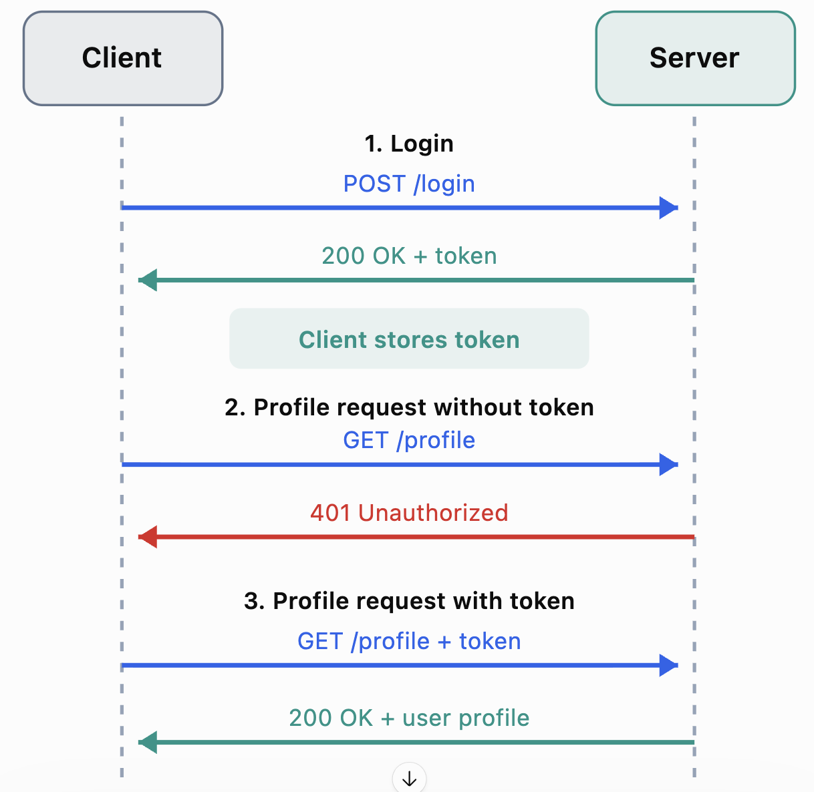
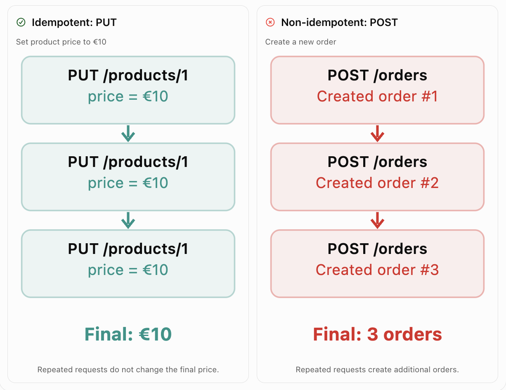
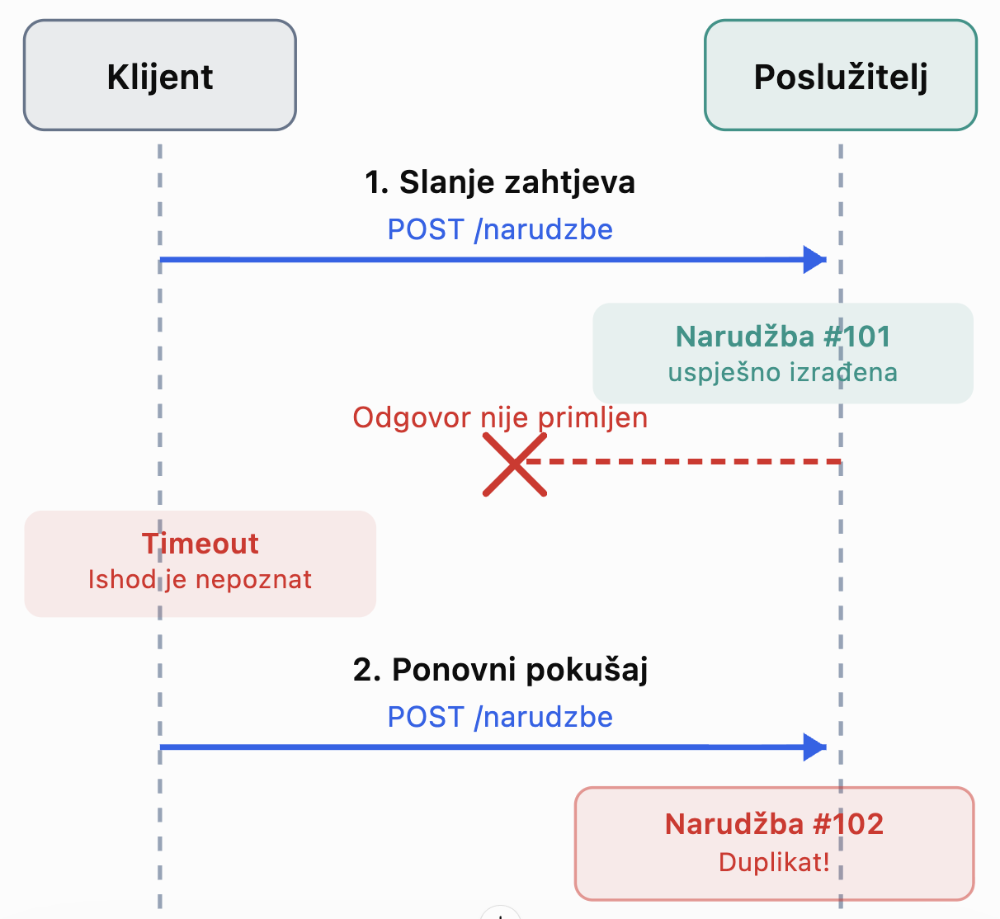
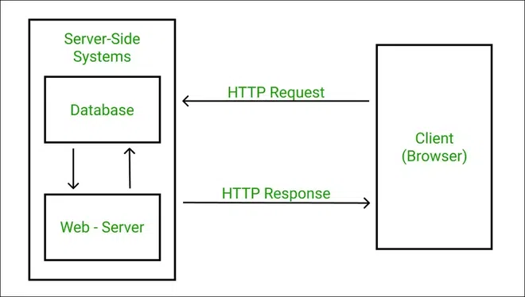
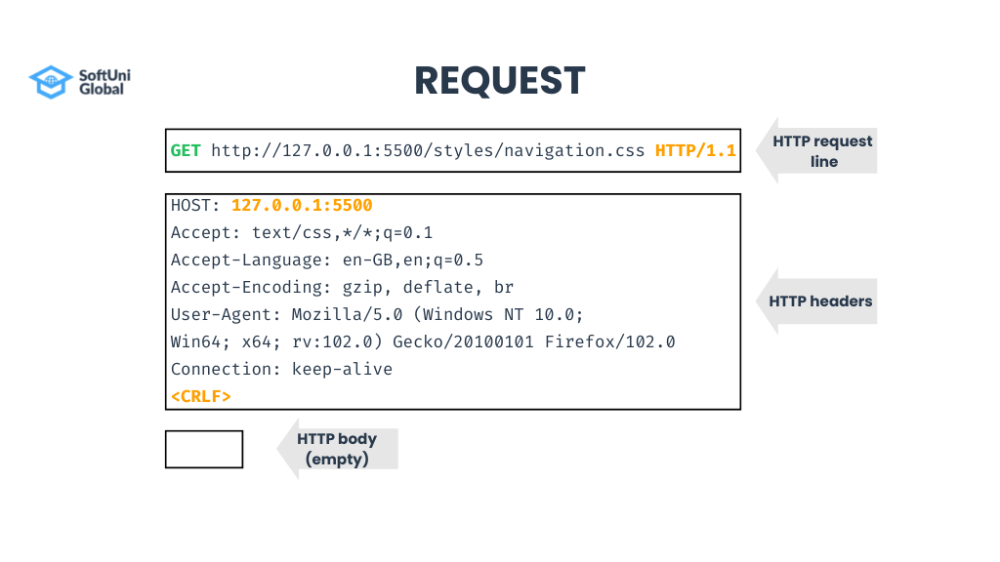
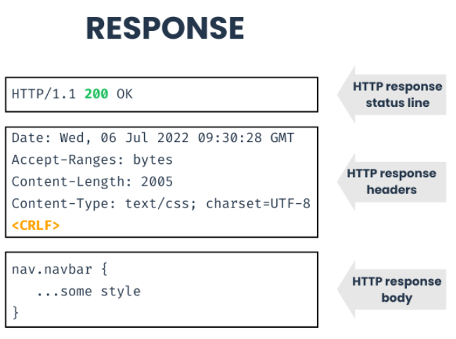
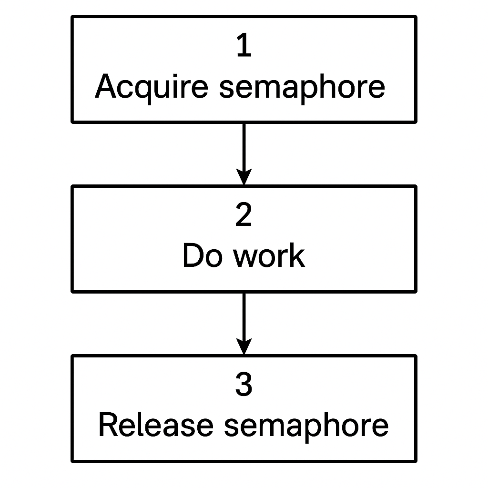
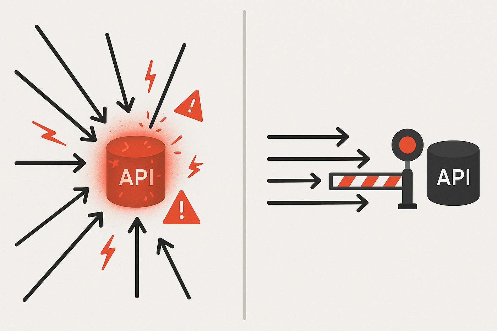

# Raspodijeljeni sustavi ([RS - 273470](https://fipu.unipu.hr/fipu/predmet/rassus_a))


**Nositelj**: doc. dr. sc. Nikola Tanković  
**Asistent**: Luka Blašković, mag. inf.

**Ustanova**: Sveučilište Jurja Dobrile u Puli, Fakultet informatike u Puli

</img>

# (4) Asinkroni Python: Konkurentna obrada mrežnih operacija

</img>

<div style="float: clear; margin-right:5px;">
Na prethodnim vježbama upoznali smo temeljne koncepte asinkronog programiranja u Pythonu koristeći biblioteku <code>asyncio</code>. Naučili smo kako definirati i pokretati korutine te konkurentno izvršavati kod pomoću <code>asyncio.gather</code> i <code>asyncio.create_task</code>, a upoznali smo i ulogu <i>event loop</i> mehanizma koji omogućava učinkovito izvršavanje korutina unutar jedne dretve u Pythonu – samu konkurentnost.

Istaknuli smo kako I/O-operacije često predstavljaju usko grlo u programima jer zahtijevaju čekanje na vanjske resurse, primjerice mrežne odgovore, pristup datotekama ili komunikaciju s bazama podataka. Učinkovito upravljanje takvim operacijama kroz konkurentno izvođenje ključno je za razvoj raspodijeljenih sustava, u kojima se funkcionalnosti nalaze na više čvorova međusobno povezanih mrežom.

Do sada smo sve primjere temeljili na simuliranim I/O-operacijama koristeći `asyncio.sleep`, što nam je omogućilo razumijevanje osnovnih principa asinkronog programiranja. Na ovim ćemo se vježbama fokusirati na praktičnu primjenu asinkronog programiranja i konkurentne obrade u kontekstu stvarnih I/O-operacija – **obrade mrežnih zahtjeva kroz HTTP-protokol**.

</div>
<br>

**🆙 Posljednje ažurirano: 19.11.2026.**

## Sadržaj

- [Raspodijeljeni sustavi (RS - 273470)](#raspodijeljeni-sustavi-rs---273470)
- [(4) Asinkroni Python: Konkurentna obrada mrežnih operacija](#4-asinkroni-python-konkurentna-obrada-mrežnih-operacija)
  - [Sadržaj](#sadržaj)
- [1. HTTP (Hypertext Transfer Protocol)](#1-http-hypertext-transfer-protocol)
  - [1.1. HTTP u raspodijeljenim sustavima](#11-http-u-raspodijeljenim-sustavima)
  - [1.2. Osnove HTTP-protokola](#12-osnove-http-protokola)
    - [1.2.1. Struktura HTTP-zahtjeva](#121-struktura-http-zahtjeva)
    - [1.2.2. Struktura HTTP-odgovora](#122-struktura-http-odgovora)
  - [1.3. HTTP statusni kodovi](#13-http-statusni-kodovi)
- [2. Konkurentna obrada mrežnih operacija pomoću biblioteka `aiohttp` i `httpx`](#2-konkurentna-obrada-mrežnih-operacija-pomoću-biblioteka-aiohttp-i-httpx)
  - [2.1. Kako šaljemo HTTP-zahtjeve sinkrono (biblioteka `requests`)?](#21-kako-šaljemo-http-zahtjeve-sinkrono-biblioteka-requests)
    - [Primjer 1: Dohvat jedne činjenice i čitanje JSON-odgovora](#primjer-1-dohvat-jedne-činjenice-i-čitanje-json-odgovora)
    - [Primjer 2: Sekvencijalno slanje 5 i 15 zahtjeva](#primjer-2-sekvencijalno-slanje-5-i-15-zahtjeva)
  - [2.2. Kako šaljemo HTTP-zahtjeve konkurentno (`aiohttp` i `httpx`)?](#22-kako-šaljemo-http-zahtjeve-konkurentno-aiohttp-i-httpx)
    - [2.2.1. Context Manager `with`](#221-context-manager-with)
    - [2.2.2. Asinkroni klijenti `ClientSession` i `AsyncClient`](#222-asinkroni-klijenti-clientsession-i-asyncclient)
      - [Primjer 3: Dohvat činjenica pomoću asinkronog klijenta](#primjer-3-dohvat-činjenica-pomoću-asinkronog-klijenta)
    - [2.2.3. Konkurentna obrada HTTP-zahtjeva (`asyncio.gather`)](#223-konkurentna-obrada-http-zahtjeva-asynciogather)
      - [Primjer 4: Pet konkurentnih zahtjeva u zajedničkoj HTTP-sesiji](#primjer-4-pet-konkurentnih-zahtjeva-u-zajedničkoj-http-sesiji)
    - [2.2.4. Mjerenja vremena konkurentnih HTTP zahtjeva](#224-mjerenja-vremena-konkurentnih-http-zahtjeva)
      - [Primjer 5: Usporedba sekvencijalnog i konkurentnog slanja 5 i 15 zahtjeva](#primjer-5-usporedba-sekvencijalnog-i-konkurentnog-slanja-5-i-15-zahtjeva)
    - [2.2.5. Konkurentna obrada HTTP-zahtjeva (`asyncio.Task`)](#225-konkurentna-obrada-http-zahtjeva-asynciotask)
      - [Primjer 6: Raspoređivanje zadataka i prikupljanje rezultata](#primjer-6-raspoređivanje-zadataka-i-prikupljanje-rezultata)
      - [Primjer 7: Redoslijed pristizanja odgovora](#primjer-7-redoslijed-pristizanja-odgovora)
  - [2.3. Timeout mrežnih operacija i obrada iznimki (`asyncio.wait_for`)](#23-timeout-mrežnih-operacija-i-obrada-iznimki-asynciowait_for)
    - [Primjer 8: Simulacija pogreške i kašnjenja prometne kamere](#primjer-8-simulacija-pogreške-i-kašnjenja-prometne-kamere)
    - [Primjer 9: Vremensko ograničenje za skup kamera i za pojedinu kameru](#primjer-9-vremensko-ograničenje-za-skup-kamera-i-za-pojedinu-kameru)
    - [Primjer 10: Vremensko ograničenje pri dohvatu s API-ja](#primjer-10-vremensko-ograničenje-pri-dohvatu-s-api-ja)
- [3. Ograničavanje konkurentnosti kroz `asyncio.Semaphore`](#3-ograničavanje-konkurentnosti-kroz-asynciosemaphore)
  - [3.1. Primjer kamera: Bez ograničavanja konkurentnosti](#31-primjer-kamera-bez-ograničavanja-konkurentnosti)
  - [3.2. Primjer kamera: S ograničavanjem konkurentnosti (`asyncio.Semaphore`)](#32-primjer-kamera-s-ograničavanjem-konkurentnosti-asynciosemaphore)
- [4. Retry i backoff strategije](#4-retry-i-backoff-strategije)
- [5. Zadaci za vježbu: Konkurentna obrada HTTP zahtjeva, timeout, ograničavanje konkurentnosti i retry/backoff strategije](#5-zadaci-za-vježbu-konkurentna-obrada-http-zahtjeva-timeout-ograničavanje-konkurentnosti-i-retrybackoff-strategije)

<div style="page-break-after: always; break-after: page;"></div>

# 1. HTTP (Hypertext Transfer Protocol)

HTTP-protokol dominantan je mrežni protokol na aplikacijskoj razini (_application-level protocol_) koji se koristi u modernim web-aplikacijama i _web-facing_ raspodijeljenim sustavima. Predstavlja jednostavan, ali snažan _real-world_ mehanizam za razmjenu podataka između nezavisnih čvorova u sustavu.

HTTP je **_request-response_** protokol osmišljen prema modelu _klijent-poslužitelj_ ([client-server model](https://en.wikipedia.org/wiki/Client%E2%80%93server_model)).

- **Klijent** (_engl. client_) inicira komunikaciju slanjem HTTP-zahtjeva poslužitelju radi dohvaćanja, slanja ili izmjene resursa.
- **Poslužitelj** (_engl. server_) prima HTTP-zahtjev, obrađuje ga i klijentu vraća HTTP-odgovor koji sadrži statusni kod, a može sadržavati i tražene podatke.

> Podsjetnik: Na kolegiju Web aplikacije klijent nam je bila Vue.js web-aplikacija koja se izvodi u web-pregledniku, dok je poslužitelj bio Node.js Express server koji je obrađivao HTTP-zahtjeve i komunicirao s bazom podataka MongoDB. U raspodijeljenom sustavu **isti servis može imati obje uloge**. Kad Express primi zahtjev Vue.js aplikacije, ima ulogu poslužitelja. Kad pošalje HTTP-zahtjev drugom servisu, u toj je razmjeni klijent.

**Kratka povijest HTTP-a**:

Prva verzija HTTP-a, [HTTP/0.9](https://developer.mozilla.org/en-US/docs/Web/HTTP/Guides/Evolution_of_HTTP), služila je za prijenos HTML-stranica. HTTP/1.0 uveo je zaglavlje `Content-Type` kojim se označava vrsta sadržaja. Danas se HTTP koristi za prijenos HTML-a, JSON-a, XML-a, slika, zvuka, videa i drugih vrsta podataka.

</img>

> **Slika 1.** HTTP-zahtjevima mogu se "dohvatiti" preko mreže razni resursi s različitih poslužitelja.

## 1.1. HTTP u raspodijeljenim sustavima

Mnogi web-servisi i mikroservisi koriste HTTP za međusobnu komunikaciju. HTTP je **široko prihvaćen**, **implementiran** i detaljno **dokumentiran** u gotovo svim modernim programskim jezicima, operacijskim sustavima, platformama i cloud okruženjima.

**Primjeri korištenja HTTP-protokola u raspodijeljenim sustavima:**

| Primjer                      | Opis                                                                                                                                          |
| ---------------------------- | --------------------------------------------------------------------------------------------------------------------------------------------- |
| Web-aplikacije               | Preglednik šalje HTTP-zahtjeve poslužitelju kako bi dohvatio web-stranice i podatke.                                                          |
| REST API                     | Aplikacije i servisi razmjenjuju podatke koristeći HTTP-metode poput `GET`, `POST`, `PUT` i `DELETE`.                                         |
| Mikroservisi                 | Neovisni servisi unutar iste raspodijeljene aplikacije komuniciraju putem HTTP-a.                                                             |
| Servisi u oblaku             | Aplikacije putem HTTP API-ja pohranjuju datoteke i upravljaju resursima u oblaku.                                                             |
| IoT sustavi                  | Senzori i pametni uređaji šalju podatke udaljenim poslužiteljima putem HTTP-a.                                                                |
| Raspodijeljene baze podataka | Neki sustavi za pohranu i pretraživanje podataka, poput Elasticsearcha, omogućuju pristup podacima i upravljanje indeksima putem HTTP API-ja. |

**Protokoli i komunikacijski okviri u raspodijeljenim sustavima**

| Protokol ili okvir            | Osnovna namjena                                                                | Primjeri primjene                                                              |
| ----------------------------- | ------------------------------------------------------------------------------ | ------------------------------------------------------------------------------ |
| HTTP/HTTPS                    | Razmjena zahtjeva i odgovora između klijenta i poslužitelja                    | REST API-ji, mikroservisi, web-aplikacije                                      |
| TCP                           | Pouzdan prijenos podataka uspostavljenom vezom uz očuvanje redoslijeda bajtova | HTTP/1.1, HTTP/2, povezivanje s bazama podataka, RPC                           |
| UDP                           | Prijenos datagrama bez prethodne uspostave veze                                | Mrežne igre, DNS upiti, QUIC                                                   |
| WebSocket                     | Dvosmjerna razmjena poruka preko trajne veze                                   | Razgovor uživo, obavijesti, ažuriranje nadzornih ploča                         |
| gRPC                          | Udaljeni pozivi procedura (RPC) preko HTTP/2                                   | Pozivanje funkcija jednog mikroservisa iz drugoga                              |
| AMQP                          | Pouzdana asinkrona razmjena poruka                                             | Redovi poruka i obrada pozadinskih zadataka uz RabbitMQ                        |
| MQTT                          | Razmjena poruka objavom i pretplatom na teme uz mali komunikacijski trošak     | IoT uređaji, senzori, telemetrija                                              |
| HTTP/3 (QUIC)                 | Razmjena HTTP zahtjeva i odgovora preko QUIC-a, koji koristi UDP               | Web-aplikacije i API-ji koji podržavaju HTTP/3                                 |
| DNS                           | Razrješavanje naziva domena i pronalaženje servisa                             | Dohvat IP adrese poslužitelja ili pronalaženje poslužitelja za određeni servis |
| Protokol sustava Apache Kafka | Objava i čitanje tokova događaja u raspodijeljenom sustavu                     | Arhitekture vođene događajima, povezivanje faza obrade podataka                |

### HTTP je _stateless_ protokol <!-- omit in toc -->

HTTP je [_stateless_ protokol](https://www.rfc-editor.org/rfc/rfc9110.html#section-3.3). To znači da se svaki zahtjev može protumačiti neovisno o prethodnim zahtjevima na istoj vezi. Aplikacija pritom može čuvati stanje, primjerice korisničku sesiju.



> **Slika 2.** Ilustracija autentifikacije i dohvaćanja korisničkih podataka na endpointu `/profile`. Nakon prvog zahtjeva (prijava), ne mora značiti da će poslužitelj zapamtiti korisnika i da će svaki sljedeći zahtjev biti autoriziran. U token-based API sustavima, klijent mora poslati valjani token u svakom sljedećem HTTP-zahtjevu kako bi poslužitelj mogao autorizirati korisnika.

[Idempotentnost](https://www.rfc-editor.org/rfc/rfc9110.html#section-9.2.2) znači da **ponavljanje istog zahtjeva ima isti namjeravani učinak na poslužitelju kao i jedan zahtjev**. Metode `GET`, `PUT` i `DELETE` idempotentne su, dok za `POST` to ovisi o konkretnoj operaciji. Primjerice, prvi zahtjev `DELETE /korisnici/42` može vratiti `204 No Content`, a ponovljeni `404 Not Found`. U oba slučaja korisnik nakon zahtjeva više ne postoji.



> **Slika 3.** PUT je idempotentan jer ponovljeni zahtjevi s istim podacima neće promijeniti stanje resursa `products`, odnosno operacija ažuriranja cijene proizvoda na 10€ (PUT /products/1 {"price": 10}) neće imati dodatni učinak na stanje resursa. S druge strane, `POST /orders` nije idempotentan jer ponovljeni zahtjevi mogu stvoriti više narudžbi.

Za [**otpornost na pogreške**](https://en.wikipedia.org/wiki/Fault_tolerance) (_engl. fault tolerance_) važno je razlikovati primitak odgovora od isteka vremena čekanja. Statusnim kodom `503 Service Unavailable` poslužitelj javlja da privremeno ne može obraditi zahtjev. Ako nakon slanja zahtjeva `POST /narudzbe` istekne vrijeme čekanja, poslužitelj je možda već izradio narudžbu. Ponavljanjem zahtjeva klijent tada može izraditi još jednu.



> **Slika 4.** U slučaju isteka vremena čekanja, klijent ne zna je li poslužitelj obradio zahtjev ili ne. Ako je poslužitelj već izradio narudžbu, ponovljeni zahtjev može stvoriti dupliciranu narudžbu ako nema implementiran mehanizam za provjeru dupliciranih zahtjeva.

### Analiza HTTP-zahtjeva pokazuje gdje se u stvarnim I/O-operacijama javljaju uska grla <!-- omit in toc -->

U radu s mrežnim operacijama često se susrećemo s uskim grlima koja mogu znatno utjecati na performanse. Mrežne su operacije sporije od operacija u memoriji ili na disku zbog latencije, ograničene propusnosti, zagušenja mreže i drugih faktora (više o tome na predavanjima iz kolegija).

Ključno je razumjeti da se **najveća uska grla** (_engl. bottlenecks_) u raspodijeljenim sustavima **gotovo uvijek javljaju u mrežnoj komunikaciji**, a ne u računalnoj snazi (_computing resources_ – CPU, RAM, disk).

HTTP-zahtjevi nam omogućuju simulaciju sljedećeg:

- **RPC-like poziva**: izvršavanje funkcija na udaljenim poslužiteljima (temelj mnogih mikroservisnih arhitektura)

- **sporih i nepouzdanih mrežnih uvjeta**: latencije, gubitka paketa, ograničene propusnosti i drugih realnih mrežnih karakteristika

- **komunikacije i međuovisnosti između servisa**: testiranje ponašanja složenih sustava sastavljenih od više međusobno povezanih servisa

Ovo čini HTTP idealnim za učenje i demonstraciju sljedećih koncepata:

- konkurentnosti
- asinkronog programiranja
- _timeout_ i _retry_ mehanizama
- _fault tolerancea_
- propagacije kvarova (_failure propagation_)

**Zaključno**: HTTP predstavlja jednostavan i nenametljiv protokol, lako razumljiv te pogodan za implementaciju u raznim programskim jezicima, a pritom osigurava jasan i predvidljiv komunikacijski model između klijenta i poslužitelja. U kontekstu raspodijeljenih sustava preporučljivo je započeti upravo s HTTP-om prije razmatranja složenijih rješenja poput gRPC-a ili WebSocketa.

## 1.2. Osnove HTTP-protokola

Tipičan komunikacijski model HTTP-a (**klijent ↔ poslužitelj**) temelji se na razmjeni HTTP-zahtjeva i HTTP-odgovora.

**HTTP-zahtjev** (_engl. HTTP request_) predstavlja poruku koju klijent upućuje poslužitelju radi dohvaćanja, slanja ili izmjene resursa. Primjerice, web-preglednik šalje HTTP-zahtjev za određeni resurs udaljenom poslužitelju, npr. HTTP-zahtjev za izvršavanje bankovne transakcije prema API-ju _transaction-service_ mikroservisa.

**HTTP-odgovor** (_engl. HTTP response_) predstavlja poruku koju poslužitelj vraća klijentu kao rezultat obrade zahtjeva. Primjerice, poslužitelj može vratiti HTTP-odgovor s JSON-podacima u tijelu odgovora, npr. HTTP-odgovor u formatu JSON s podacima o autentificiranom korisniku.

</img>

> **Slika 5.** Komunikacijski model HTTP-a: klijent šalje HTTP-zahtjev poslužitelju, koji obrađuje zahtjev i vraća HTTP-odgovor klijentu.

### 1.2.1. Struktura HTTP-zahtjeva

- **Metoda** (_engl. method_): označava tip operacije koju klijent želi izvršiti nad resursom (npr. `GET`, `POST`, `PUT`, `PATCH`, `DELETE`).

- **URL** (_engl. Uniform Resource Locator_): specificira lokaciju resursa na poslužitelju (npr. `https://api.github.com/users/neki_korisnik`). Sastoji se od sljedećih komponenti:
  - **Shema** (_engl. scheme_): definira protokol komunikacije (npr. `https`).
  - **Domena** (_engl. domain_): predstavlja naziv poslužitelja (npr. `api.github.com`).
  - **Route parametar** (_engl. route parameter_): opisuje dinamički dio putanje koji često identificira pojedini resurs (npr. `/users/:id`).
  - **Query parametar** (_engl. query parameter_): dodatan parametar upita koji se koristi za filtriranje, paginaciju, sortiranje i sl. (npr. `?page=1&limit=10`).
  - **Fragment** (_engl. fragment_): označava dio resursa, najčešće za navigaciju unutar dokumenta (npr. `#section1`).

- **Zaglavlja** (_engl. headers_): pružaju metainformacije o zahtjevu, poput tipa sadržaja, autentikacije ili preferiranog formata odgovora (npr. `Content-Type: application/json`).

- **Tijelo** (_engl. body_): sadrži podatke koje klijent šalje poslužitelju, najčešće u formatima poput JSON-a, XML-a ili form-data; koristi se primarno u metodama `POST`, `PUT` i `PATCH`.

- **Verzija protokola** (_engl. protocol version_): označava verziju HTTP-protokola korištenu u zahtjevu (npr. `HTTP/1.1`, `HTTP/2`, `HTTP/3`).

</img>

> **Slika 6.** Struktura HTTP-zahtjeva: metoda, URL, zaglavlja i tijelo zahtjeva.

**Najčešće korištene HTTP-metode** imaju [jasno definirane semantike](https://dzone.com/articles/rest-and-http-semantics) i koriste se u skladu **s namjerom operacije nad resursom**:

- **GET**: dohvaća jedan ili više resursa s poslužitelja (npr. podatke o korisniku).
- **POST**: šalje podatke na poslužitelj radi stvaranja novog resursa ili obrade poslanih podataka (npr. slanje podataka iz forme).
- **PUT**: u potpunosti zamjenjuje postojeći resurs novim podatcima (npr. ažuriranje kompletnog profila korisnika).
- **PATCH**: djelomično ažurira postojeći resurs (npr. promjena lozinke ili ažuriranje samo jednog polja).
- **DELETE**: trajno uklanja resurs s poslužitelja (npr. brisanje korisnika).

---

#### Dodatna pojašnjenja i primjeri HTTP-zahtjeva <!-- omit in toc -->

**Metoda GET**  
Koristi se isključivo za dohvaćanje podataka. Često se kombinira s **query parametrima** (filtriranje, sortiranje, paginacija) ili s **route parametrima** kada je potrebno dohvatiti konkretan resurs (npr. korisnika prema ID-u). Važno je naglasiti da slanje **tijela zahtjeva** unutar metode GET nije u skladu sa standardom i općenito se ne prakticira.

**Metoda POST**  
Primjenjuje se kada je potrebno poslati podatke na poslužitelj, najčešće radi stvaranja novog resursa ili obrade ulaznih podataka. Podaci se prosljeđuju u **tijelu zahtjeva**, obično u JSON-formatu, što omogućuje slanje kompleksnih struktura koje ne bi bilo prikladno slati putem query parametara. Prednost je i to što se podaci ne prikazuju u URL-u.

**Metode PUT i PATCH**  
Obje se koriste za ažuriranje postojećeg resursa, no semantika se razlikuje:

- **PUT** zahtijeva slanje **cjelovitog** skupa podataka resursa te u pravilu zamjenjuje postojeći resurs novim.
- **PATCH** omogućuje **djelomičnu izmjenu**, pa se šalju samo ona polja koja je potrebno ažurirati.

U oba slučaja podaci za ažuriranje šalju se u **tijelu zahtjeva**, najčešće u JSON-formatu.

---

Pokazat ćemo nekoliko primjera slanja HTTP-zahtjeva koristeći CLI-alat `curl`.

**Sintaksa:**

```bash
→ curl -X <METODA> "<URL>" [DODATNE_OPCIJE]
→ curl -X <METODA> "<URL>" -H "Content-Type: application/json" -d '<PODACI>'
```

_Primjer:_ HTTP-zahtjev koji dohvaća podatke o korisniku `pero_peric`:

```bash
→ curl -X GET "https://api.github.com/users/pero_peric"
```

> Pokušajte poslati zahtjev u terminalu sa svojim korisničkim imenom na GitHubu kako biste dobili HTTP-odgovor s javno dostupnim podacima o svojem profilu.

_Primjer:_ HTTP-zahtjev koji šalje podatke o novom korisniku na poslužitelj:

- Opcija `-d` označava podatke koji se šalju u tijelu zahtjeva
- Opcija `-H` označava zaglavlje zahtjeva
- Zaglavlje `Content-Type: application/json` specificira da su podaci u JSON-formatu
- Oznakom `\` možemo razbiti naredbu na više redaka radi bolje čitljivosti

```bash
→ curl -X POST "https://api.github.com/users" \
  -H "Content-Type: application/json" \
  -d '{
        "username": "pero_peric",
        "email": "pperic@gmail.com",
        "password": "pero123"
      }'
```

> Napomena: Primjeri su ilustrativni; GitHub API ne podržava stvaranje korisnika putem javnog API-ja ni brisanje/ažuriranje postojećih korisnika.

_Primjer:_ HTTP-zahtjev koji ažurira username korisnika `pero_peric`:

```bash
→ curl -X PATCH "https://api.github.com/users/pero_peric" \
-H "Content-Type: application/json" \
-d '{
"username": "pero_peric_2"
}'
```

_Primjer:_ HTTP-zahtjev koji briše korisnika `pero_peric`:

```bash
→ curl -X DELETE "https://api.github.com/users/pero_peric"
```

_Primjer:_ HTTP-zahtjev koji dohvaća samo korisnike s imenom `pero`:

```bash
→ curl -X GET "https://api.github.com/users?name=pero"
```

_Primjer:_ HTTP-zahtjev koji zamjenjuje sve podatke o korisniku `pero_peric`:

```bash
→ curl -X PUT "https://api.github.com/users/pero_peric" \
 -H "Content-Type: application/json" \
 -d '{
"username": "pero_peric_2",
"email": "pperic2@gmail.com",
"password": "ppppero1234"
}'
```

> Iz navedenih primjera uočite dijelove HTTP-zahtjeva: metodu, URL, zaglavlja i tijelo zahtjeva.

### 1.2.2. Struktura HTTP-odgovora

- **Statusna linija** (_engl. status line_): uključuje **statusni kod** i pripadajuću **tekstualnu poruku** (npr. `200 OK`), pri čemu brojčana vrijednost (`200`) označava rezultat obrade zahtjeva, a tekstualni opis (`OK`) pruža kratko objašnjenje stanja.
- **Zaglavlja** (_engl. headers_): pružaju **dodatne informacije o odgovoru**, poput formata podataka, duljine sadržaja ili informacija o keširanju (npr. `Content-Type: application/json`).
- **Tijelo** (_engl. body_): sadrži **podatke koje poslužitelj vraća klijentu**, najčešće u formatima kao što su JSON, HTML ili XML.
- **Verzija protokola** (_engl. protocol version_): specificira **verziju HTTP-protokola** korištenu u odgovoru (npr. `HTTP/1.1`).

</img>

> **Slika 7.** Struktura HTTP-odgovora: statusna linija, zaglavlja i tijelo odgovora.

## 1.3. HTTP statusni kodovi

Statusni kod je troznamenkasti broj u HTTP-odgovoru. Prva znamenka označava skupinu kojoj kod pripada.

| Raspon          | Skupina                 | Značenje                                                                                                  |
| --------------- | ----------------------- | --------------------------------------------------------------------------------------------------------- |
| `1xx` (100–199) | Informacijski odgovori  | Klijent prima privremenu informaciju prije konačnog odgovora.                                             |
| `2xx` (200–299) | Uspješni odgovori       | Poslužitelj je uspješno primio, razumio i prihvatio zahtjev.                                              |
| `3xx` (300–399) | Preusmjeravanja         | Za dovršetak zahtjeva potreban je dodatni korak, primjerice slanje zahtjeva na novu adresu.               |
| `4xx` (400–499) | Klijentske pogreške     | Poslužitelj ne može ispuniti zahtjev, primjerice zbog neispravnih podataka ili nedostatka prava pristupa. |
| `5xx` (500–599) | Poslužiteljske pogreške | Pogreška na strani poslužitelja sprječava obradu zahtjeva.                                                |

**Najčešći statusni kodovi**

| Statusni kod                | Značenje                                                | Primjer                                                             |
| --------------------------- | ------------------------------------------------------- | ------------------------------------------------------------------- |
| `200 OK`                    | Zahtjev je uspješno obrađen.                            | `GET /proizvodi/1` vraća podatke o proizvodu.                       |
| `201 Created`               | Stvoren je novi resurs.                                 | `POST /narudzbe` stvara narudžbu.                                   |
| `204 No Content`            | Zahtjev je uspješno obrađen, a odgovor nema tijelo.     | Nakon brisanja proizvoda poslužitelj vraća samo zaglavlja i status. |
| `301 Moved Permanently`     | Resurs je trajno premješten.                            | Zaglavlje `Location` upućuje na novu adresu.                        |
| `400 Bad Request`           | Zahtjev je neispravan.                                  | Tijelo zahtjeva sadrži sintaksno neispravan JSON.                   |
| `401 Unauthorized`          | Zahtjevu nedostaju valjani autentifikacijski podaci.    | Pristupni token za dohvat profila je istekao.                       |
| `403 Forbidden`             | Poslužitelj je razumio zahtjev, ali ga odbija ispuniti. | Prijavljeni korisnik nema pravo obrisati tuđu narudžbu.             |
| `404 Not Found`             | Poslužitelj nije pronašao traženi resurs.               | Klijent traži narudžbu s nepostojećim identifikatorom.              |
| `409 Conflict`              | Zahtjev je u sukobu s trenutačnim stanjem resursa.      | Klijent pokušava izmijeniti narudžbu koja je već poslana.           |
| `500 Internal Server Error` | Neočekivana pogreška spriječila je obradu zahtjeva.     | Pri obradi zahtjeva pojavila se neobrađena iznimka.                 |
| `503 Service Unavailable`   | Poslužitelj privremeno ne može obraditi zahtjev.        | Servis je preopterećen ili je u tijeku održavanje.                  |

Detaljnija objašnjenja dostupna su u [Mozillinu pregledu HTTP statusnih kodova](https://developer.mozilla.org/en-US/docs/Web/HTTP/Status).

---

> Napomena: Studentima kojima sažetak iz ovog poglavlja nije dovoljan za jasno razumijevanje HTTP-protokola preporučuje se da dodatno prouče skriptu WA1 iz kolegija Web aplikacije, dostupnu na [GitHubu kolegija](https://github.com/lukablaskovic/FIPU-WA/tree/main/WA1%20-%20Uvod%20u%20HTTP%2C%20Node%20i%20Express).

<div style="page-break-after: always; break-after: page;"></div>

# 2. Konkurentna obrada mrežnih operacija pomoću biblioteka `aiohttp` i `httpx`

Biblioteke **`aiohttp` i `httpx`** omogućuju asinkrono slanje HTTP-zahtjeva. Dok jedna korutina čeka odgovor poslužitelja, _event loop_ može nastaviti izvršavati druge zadatke. Usporedimo klijente koje ćemo koristiti u primjerima.

| Biblioteka | Kako šaljemo GET-zahtjev?                           | Što se događa dok čekamo odgovor?                                                              |
| ---------- | --------------------------------------------------- | ---------------------------------------------------------------------------------------------- |
| `requests` | `requests.get(url)`                                 | Poziv je sinkron i blokira dretvu koja ga izvršava.                                            |
| `aiohttp`  | `await session.get(url)` uz `aiohttp.ClientSession` | Korutina prepušta upravljanje _event loopu_ dok čeka na mrežu.                                 |
| `httpx`    | `await client.get(url)` uz `httpx.AsyncClient`      | Čekanje je također asinkrono. Biblioteka nudi i sinkrono sučelje, primjerice `httpx.get(url)`. |

Biblioteka `aiohttp` podržava i izradu HTTP-poslužitelja te rad s WebSocketima. U ovom poglavlju obje biblioteke koristimo kao HTTP-klijente. [Dokumentacija za aiohttp](https://docs.aiohttp.org/en/stable/client_quickstart.html) · [Dokumentacija za HTTPX](https://www.python-httpx.org/async/)

#### Instalacija biblioteka <!-- omit in toc -->

Modul `asyncio` dio je standardne biblioteke Pythona. Pakete za rad s HTTP-om instalirajte u virtualno okruženje projekta.

Ako ste se odlučili koristiti `conda` alat za upravljanje virtualnim okruženjima, stvorite novo virtualno okruženje naziva `rs4` prije instalacije paketa:

```bash
→ conda create --name rs4 python=3.13
```

Aktivirajte okruženje:

```bash
→ conda activate rs4
```

Unutar VS Codea promijenite _interpreter_ na novokreirano okruženje `rs4` kako biste izbjegli [linting greške](https://stackoverflow.com/questions/8503559/what-is-linting).

```bash
→ CTRL/CMD + SHIFT + P -> Python: Select Interpreter -> rs4
```

<a href="https://github.com/lukablaskovic/FIPU-RS/blob/main/RS4%20-%20Asinkroni%20Python%20-%20Konkurentna%20obrada%20mre%C5%BEnih%20operacija/CleanShot%202026-11-19%20at%2000.23.15.png"></a>

> **Slika 8.** Odabir ispravnog _interpreter-a_ u VS Codeu omogućuje da se prilikom pokretanja skripti koristi Python iz virtualnog okruženja, a ne globalne distribucije.

U aktiviranom okruženju pokrenite sljedeću naredbu.

```bash
python -m pip install requests aiohttp httpx
```

<div style="page-break-after: always; break-after: page;"></div>

## 2.1. Kako šaljemo HTTP-zahtjeve sinkrono (biblioteka `requests`)?

Za početak šaljemo zahtjeve sinkrono. U ovoj usporedbi i `requests.get()` i `httpx.get()` blokiraju trenutnu dretvu dok se odgovor ne preuzme. Asinkroni klijent `httpx.AsyncClient` uvest ćemo u poglavlju 2.2.

Uključimo `requests` biblioteku:

```python
import requests
```

Jednostavni primjer slanja GET-zahtjeva na poslužitelj. Zahtjev ćemo poslati na [Cat Facts API](https://catfact.ninja/) servis koji vraća nasumične činjenice o mačkama:

**Sintaksa:**

```
requests.HTTP_METHOD("<URL>")
```

- `HTTP_METHOD` predstavlja HTTP-metodu koju želimo koristiti (npr. `GET`, `POST`, `PUT`, `DELETE`).
- `<URL>` je URL-adresa na koju šaljemo zahtjev.
  _Primjer HTTP GET:_ `requests.get("https://catfact.ninja/fact")` šalje GET-zahtjev na navedeni URL.
  _Primjer HTTP POST:_ `requests.post("https://example.com/api", json=python_dict)` šalje POST-zahtjev s podacima u tijelu zahtjeva.

Isti pozivi u sinkronoj inačici biblioteke `httpx` glase `httpx.get("https://catfact.ninja/fact")` i `httpx.post("https://example.com/api", json=python_dict)`.

### Primjer 1: Dohvat jedne činjenice i čitanje JSON-odgovora

Primjer slanja GET-zahtjeva na endpoint `/fact`:

URL servisa: `https://catfact.ninja`

```python
import requests

response = requests.get("https://catfact.ninja/fact") # HTTP GET-zahtjev
print(response.text) # ispis tijela HTTP-odgovora
```

**Isti primjer uz sinkroni `httpx`**

```python
import httpx

response = httpx.get("https://catfact.ninja/fact") # HTTP GET-zahtjev
print(response.text) # ispis tijela HTTP-odgovora
```

Ako pokrenemo ovaj kod, ispisat će se tijelo odgovora u formatu JSON s ključevima `fact` i `length`:

```python
{
  "fact": "The life expectancy of cats has nearly doubled over the last fifty years.",
  "length": 73
}
```

U obje biblioteke možemo provjeriti statusni kod odgovora:

```python
print(response.status_code) # 200
```

Možemo i deserijalizirati JSON-odgovor koristeći metodu `json()`:

> **Prisjeti se:** [Serijalizacija](https://en.wikipedia.org/wiki/Serialization) podataka predstavlja proces pretvaranja podataka u format pogodan za prijenos ili pohranu (npr. JSON-string, dok [deserijalizacija](https://hazelcast.com/foundations/distributed-computing/deserialization/) (_unserialization/unmarshalling_) predstavlja obrnuti proces u kojem se serijalizirani podaci (npr. serija bytova/stringova) pretvaraju natrag u format pogodan za računalnu obradu (npr. Python rječnik).

```python
data = response.json() # deserijalizacija JSON-odgovora u Python rječnik
print(data["fact"])  # ispis samo činjenice o mačkama
```

Testirajte slanje nekoliko zahtjeva na isti API kako biste vidjeli različite činjenice o mačkama.

Pitanje: Kako ćete poslati zahtjev koristeći alat `curl` iz terminala?

<details>
  <summary>Spoiler alert! Odgovor na pitanje</summary>

```bash
→ curl -X GET "https://catfact.ninja/fact"
```

ili jednostavno

```bash
→ curl "https://catfact.ninja/fact"
```

s obzirom na to da je GET zadana metoda za curl.

</details>

---

<div style="page-break-after: always; break-after: page;"></div>

### Primjer 2: Sekvencijalno slanje 5 i 15 zahtjeva

Rekli smo da u sinkronim programima svaka funkcija koju pozovemo, ako traje dugo, blokira izvođenje programa dok se ne završi. To vrijedi i za HTTP-zahtjeve.

- u sinkronoj obradi svaki zahtjev koji pošaljemo **čeka na odgovor na prethodni zahtjev** prije nego što pošaljemo novi. Ako neki zahtjevi traju dugo, to može značajno usporiti izvođenje programa.

Poslat ćemo pet zahtjeva na Cat Facts API. Kod za slanje možemo staviti u jednostavnu funkciju koja šalje GET-zahtjev i ispisuje rezultat. Sam podatak možemo dohvatiti preko ključa `fact`, ali prije toga moramo **deserijalizirati JSON-odgovor** pomoću metode `json()`.

```python
import requests

def send_request():
  response = requests.get("https://catfact.ninja/fact")
  fact = response.json()["fact"]
  print(fact)

print("Šaljemo 1. zahtjev...")
send_request()

print("Šaljemo 2. zahtjev...")
send_request()

print("Šaljemo 3. zahtjev...")
send_request()

print("Šaljemo 4. zahtjev...")
send_request()

print("Šaljemo 5. zahtjev...")
send_request()
```

**Isti primjer uz sinkroni `httpx`**

```python
import httpx

def send_request():
  response = httpx.get("https://catfact.ninja/fact")
  print(response.json()["fact"])

for i in range(5):
  print(f"Šaljemo {i + 1}. zahtjev...")
  send_request()
```

<a href="https://github.com/lukablaskovic/FIPU-RS/blob/main/RS4%20-%20Asinkroni%20Python%20-%20Konkurentna%20obrada%20mre%C5%BEnih%20operacija/CleanShot%202026-11-19%20at%2000.25.16%402x.png"></a>

> **Slika 9.** Tri HTTP-zahtjeva šalju se sekvencijalno. Svaki traje jednu sekundu, pa ukupno čekanje traje tri sekunde.

Vidimo da je za izvršavanje svakog zahtjeva potrebno pričekati odgovor na prethodni zahtjev; na taj smo način napisali kod i to je OK.

Ukupno vrijeme trajanja ovog programa iznosi prosječno od 1 do 2 sekunde, ovisno prvenstveno o brzini interneta i opterećenju servisa Cat Facts API.

Izmjerit ćemo vrijeme trajanja programa pomoću funkcija `time.perf_counter()`:

```python
import requests
import time

def send_request():
  response = requests.get("https://catfact.ninja/fact")
  fact = response.json()["fact"]
  print(fact)

start = time.perf_counter() # timestamp #1

print("Šaljemo 1. zahtjev...")
send_request()

print("Šaljemo 2. zahtjev...")
send_request()

print("Šaljemo 3. zahtjev...")
send_request()

print("Šaljemo 4. zahtjev...")
send_request()

print("Šaljemo 5. zahtjev...")
send_request()

end = time.perf_counter() # timestamp #2
print(f"Izvršavanje programa traje {end - start:.2f} s.")
```

**Isti primjer uz sinkroni `httpx`**

```python
import time
import httpx

def send_request():
  response = httpx.get("https://catfact.ninja/fact")
  print(response.json()["fact"])

start = time.perf_counter()
for i in range(5):
  print(f"Šaljemo {i + 1}. zahtjev...")
  send_request()

end = time.perf_counter()
print(f"Izvršavanje programa traje {end - start:.2f} s.")
```

Poslat ćemo 15 zahtjeva, a kod ćemo strukturirati u `for` petlju:

```python
import requests
import time

def send_request():
  response = requests.get("https://catfact.ninja/fact")
  fact = response.json()["fact"]
  print(fact)

start = time.perf_counter()

for i in range(15):
  print(f"Šaljemo {i + 1}. zahtjev...")
  send_request()

end = time.perf_counter()
print(f"Izvršavanje programa traje {end - start:.2f} s.")
```

**Isti primjer uz sinkroni `httpx`**

```python
import time
import httpx

def send_request():
  response = httpx.get("https://catfact.ninja/fact")
  print(response.json()["fact"])

start = time.perf_counter()
for i in range(15):
  print(f"Šaljemo {i + 1}. zahtjev...")
  send_request()

end = time.perf_counter()
print(f"Izvršavanje programa traje {end - start:.2f} s.")
```

U ovom je mjerenju slanje 15 zahtjeva trajalo od 3 do 4 sekunde. Budući da zahtjeve šaljemo jedan za drugim, njihova se trajanja zbrajaju. Pri svakom pokretanju možemo izmjeriti drukčije vrijeme, ovisno o mrežnim uvjetima i opterećenju poslužitelja.

Zahtjeve smo do sada slali **sinkrono**, što je jasno vidljivo u ovom primjeru. Zamislimo situaciju u kojoj šaljemo 1 000 ili čak 10 000 zahtjeva – program bi tada radio izrazito dugo, a naš bi servis morao čekati da se svaki zahtjev pojedinačno obradi.

U nastavku ćemo vidjeti kako ćemo ovo riješiti asinkronim programiranjem, odnosno **konkurentnim slanjem i obradom HTTP-zahtjeva** na poslužitelj pomoću biblioteka `aiohttp` i `httpx`.

> **Napomena**: ako pošaljete previše zahtjeva, moguće je da će CatFact API blokirati zahtjeve s vaše IP-adrese te da će vam se vratiti statusni kod 429 (Too Many Requests). Možete pokušati ponovo kasnije ili koristiti alternativni API za testiranje.
> [Lista dostupnih besplatnih API-ja za testiranje](https://free-apis.github.io/#/browse) – odaberite API bez CORS ili API-key ograničenja.

<div style="page-break-after: always; break-after: page;"></div>

## 2.2. Kako šaljemo HTTP-zahtjeve konkurentno (`aiohttp` i `httpx`)?

Cilj nam je poslati više zahtjeva na _Cat Facts API_ i postići brže vrijeme izvršavanja programa (ne želimo da slanje i ispis rezultata 15 zahtjeva traju gotovo 4 sekunde).

Kada razmišljamo o konkurentnom slanju HTTP-zahtjeva, najidealnije je razmišljati o **korutinama**. Na zadnjim smo vježbama definirali korutine s fiksnim čekanjima (_non-blocking_ `asyncio.sleep`), a sada ćemo definirati korutine koje će slati HTTP-zahtjeve na neki servis.

Za primjere u nastavku učitajmo module na početku datoteke. U svakom primjeru pokrenite samo jednu inačicu: onu s bibliotekom `aiohttp` ili onu ispod komentara `# ili koristeći httpx`.

```python
import asyncio
import time

import aiohttp
import httpx
```

Kada šaljemo više zahtjeva istom poslužitelju, jedan klijent može ponovno koristiti već otvorene veze. U sinkronom kodu za to bismo koristili `requests.Session`. U asinkronom kodu otvorit ćemo jednu instancu `aiohttp.ClientSession` ili `httpx.AsyncClient` i koristiti je za sve zahtjeve.

### 2.2.1. Context Manager `with`

Koncept **kontekstnog menadžera** (_engl. Context Manager_) u Pythonu omogućuje nam automatsku alokaciju i dealokaciju resursa, odnosno upravljanje resursima koji se koriste u bloku koda.

Najčešće korišteni primjer _context managera_ u Pythonu je naredba `with` koju koristimo kako bismo definirali **blok koda za rad s resursima** koje treba eksplicitno **(1) otvoriti**, **(2) koristiti** i **(3) zatvoriti**.

Primjeri resursa koji zahtijevaju ovakvo upravljanje uključuju:

- **datoteke** (otvaranje → čitanje/pisanje → zatvaranje)
- **mrežne veze** (otvaranje → slanje zahtjeva → zatvaranje)
- **baze podataka** (otvaranje → izvršavanje upita → zatvaranje)

Naredba `with` omogućava automatsko upravljanje resursima, osiguravajući da će se resursi pravilno osloboditi i zatvoriti čak i ako dođe do greške u bloku koda. Na taj način kod postaje čišći i sigurniji za izvođenje.

Naredba `with` upravlja ulaskom u blok i izlaskom iz njega. Za resurse čije otvaranje ili zatvaranje može uključivati asinkrono čekanje koristimo **`async with`**.

**Sintaksa:**

```python
with neki_resurs as alias:
    # rad s resursom koristeći "alias"
```

Tipičan primjer korištenja naredbe `with` jest rad s datotekama:

```python
with open("datoteka.txt", "r") as file: # otvaramo datoteku za čitanje i koristimo alias "file"
    sadržaj = file.read() # čitamo sadržaj datoteke
    print(sadržaj)
```

Bez korištenja naredbe `with` morali bismo eksplicitno zatvoriti datoteku nakon što smo pročitali sadržaj:

```python
file = open("datoteka.txt", "r") # open je builtin funkcija za čitanje datoteka
sadržaj = file.read()
print(sadržaj)
file.close() # zatvaramo datoteku
```

Međutim, kod iznad ne obuhvaća slučaj greške prilikom čitanja ili pisanja u datoteku ako postoji. U tom slučaju trebali bismo koristiti `try-except-finally` blokove kako bismo osigurali da će se datoteka zatvoriti čak i ako dođe do greške.

```python
try:
  file = open("datoteka.txt", "r")
  sadržaj = file.read()
  print(sadržaj)
except Exception as e:
  print(f"Greška: {e}")
finally:
  file.close()
```

> Osim spomenutih primjera resursa možemo definirati i [vlastite kontekstne menadžere](https://book.pythontips.com/en/latest/context_managers.html). Međutim, to nije predmet ove skripte.

Naredba `with` **automatski zatvara resurs čak i ako dođe do greške u bloku koda**, što je jedan od razloga zašto se preporučuje njeno korištenje.

Dodatno, vidimo da je kod s naredbom `with` **kraći** i **lakši za čitanje**.

#### Obrada grešaka (engl. error handling) u Pythonu <!-- omit in toc -->

U Pythonu **upravljanje greškama** (_engl. error handling_) omogućava programerima da unaprijed predvide pogreške koje se mogu pojaviti tijekom izvođenja programa i pravilno reagiraju na njih. Temeljni alat za kontrolu i obradu takvih situacija jesu blokovi `try`, `except` i `finally`.

**Sintaksa:**

```python
try:
    # kod koji može izazvati grešku
except Exception as e: # Exception je bazna klasa za većinu iznimki u Pythonu, dok je "e" alijas za instancu iznimke
    # kod za rukovanje greškom
finally:
    # kod koji se uvijek izvršava, bez obzira na grešku
```

- **`try` blok**: Sadrži kod koji može potencijalno izazvati grešku. Ako se greška dogodi, Python će prekinuti izvođenje koda unutar `try` bloka i prijeći na odgovarajući `except` blok.
- **`except` blok**: Definira kako će program reagirati na određene vrste grešaka. Možemo specificirati različite vrste iznimki koje želimo uhvatiti i obraditi. Potrebno je definirati barem jedan `except` blok kako bismo uhvatili greške.
- **`finally` blok**: Sadrži kod koji će se uvijek izvršiti, bez obzira na to je li došlo do greške ili ne. Ovaj se blok često koristi za čišćenje resursa, poput zatvaranja datoteka ili mrežnih veza.

`Exception` je bazna klasa za većinu iznimaka (ali ne baš za sve) u Pythonu. Kada koristimo `except Exception as e`, uhvatit ćemo sve vrste iznimki koje se nasljeđuju iz klase `Exception`. Varijabla `e` predstavlja **instancu iznimke koja sadrži informacije o grešci**, poput poruke o grešci, i stoga je korisna za dijagnostiku.

| Iznimka             | Kada nastaje?                                                                   |
| ------------------- | ------------------------------------------------------------------------------- |
| `ValueError`        | Kada funkcija primi argument odgovarajućeg tipa, ali neprikladne vrijednosti.   |
| `TypeError`         | Kada se operacija ili funkcija primijeni na objekt neprikladnog tipa.           |
| `FileNotFoundError` | Kada se pokuša pristupiti datoteci koja ne postoji.                             |
| `ZeroDivisionError` | Kada se pokuša dijeliti s nulom.                                                |
| `KeyError`          | Kada se pokuša pristupiti nepostojećem ključu u rječniku.                       |
| `IndexError`        | Kada se pokuša pristupiti elementu liste ili niza pomoću indeksa izvan raspona. |
| `ConnectionError`   | Kada dođe do problema s mrežnom vezom.                                          |
| `TimeoutError`      | Kada istekne dopušteno vrijeme čekanja na završetak operacije.                  |
| `ImportError`       | Kada Python ne može učitati modul ili iz njega uvesti traženo ime.              |

_Primjer:_ Iznimku `ValueError` možemo uhvatiti na sljedeći način:

```python
try:
    broj = int(input("Unesite cijeli broj: "))
except ValueError as e:
    print(f"Greška: Uneseni podatak nije cijeli broj. Detalji: {e}")
```

_Primjer:_ Iznimku `FileNotFoundError` možemo uhvatiti na sljedeći način:

```python
try: # nakon try radimo indentaciju
    with open("nepostojeca_datoteka.txt", "r") as file: # nakon with bloka također radimo indentaciju
        sadržaj = file.read()
except FileNotFoundError as e:
    print(f"Greška: Datoteka nije pronađena. Detalji: {e}")
```

<div style="page-break-after: always; break-after: page;"></div>

### 2.2.2. Asinkroni klijenti `ClientSession` i `AsyncClient`

Vratimo se na svoj primjer slanja 15 zahtjeva na _Cat Facts API_. Što je ovdje resurs koji trebamo otvoriti i zatvoriti u kontekstu `with` naredbe?

<details>
  <summary>Spoiler alert! Odgovor na pitanje</summary>
  <p>Upravljamo HTTP-klijentom koji može održavati više veza s poslužiteljem. Otvaramo ga prije slanja zahtjeva i zatvaramo kada obradimo odgovore.</p>
</details>

U biblioteci `aiohttp` klijent je instanca klase **`ClientSession`**, a u biblioteci `httpx` instanca klase **`AsyncClient`**. Obje klase možemo koristiti kao asinkrone kontekstne menadžere. Unutar korutine otvaramo klijent pomoću `async with`, a izlaskom iz bloka automatski se oslobađaju njegove veze.

```python
async with aiohttp.ClientSession() as session:
    ...  # ovdje šaljemo zahtjeve

# ili koristeći httpx

async with httpx.AsyncClient() as client:
    ...  # ovdje šaljemo zahtjeve
```

#### Primjer 3: Dohvat činjenica pomoću asinkronog klijenta

U obje biblioteke GET-zahtjev šaljemo metodom `get`. Unutar korutine koristimo `await` kako bismo pričekali odgovor.

```python
async with aiohttp.ClientSession() as session:
  response = await session.get("https://catfact.ninja/fact") # šalje HTTP GET-zahtjev na navedeni URL
  print(response)

# ili koristeći httpx

async with httpx.AsyncClient() as client:
  response = await client.get("https://catfact.ninja/fact")
  print(response)
```

Kako ovo sad pozvati? **_Context manager_ sam po sebi nije funkcija ni korutina**. Zato ćemo ga pozvati unutar korutine.

Prebacujemo cijeli kod unutar `main` korutine:

```python
async def main(): # definiramo main korutinu
  async with aiohttp.ClientSession() as session: # otvaramo HTTP-sesiju koristeći context manager "with"
    response = await session.get("https://catfact.ninja/fact") # mrežni zahtjev
    print(response)

# pokrećemo main korutinu i event loop koristeći funkciju asyncio.run()
asyncio.run(main())

# ili koristeći httpx

async def main():
  async with httpx.AsyncClient() as client:
    response = await client.get("https://catfact.ninja/fact")
    print(response)

# pokrećemo main korutinu i event loop koristeći funkciju asyncio.run()
asyncio.run(main())
```

Naredba `print(response)` prikazuje sažetak objekta odgovora. Za ispis tijela odgovora u sljedećem ćemo koraku pročitati JSON.

U biblioteci **`aiohttp`** izraz `await response.json()` čeka da se tijelo odgovora pročita i vraća deserijalizirane podatke. Kod **`httpx.AsyncClient`** poziv `await client.get(...)` već je preuzeo cijelo tijelo, pa podatke čitamo običnim pozivom `response.json()`.

```python
async def main():
  async with aiohttp.ClientSession() as session:
    response = await session.get("https://catfact.ninja/fact") # mrežni zahtjev
    fact_dict = await response.json() # dodajemo await jer je json() asinkrona metoda koja vraća objekt korutine
    print(fact_dict) # ispisuje nasumičnu činjenicu

# ili koristeći httpx

async def main():
  async with httpx.AsyncClient() as client:
    response = await client.get("https://catfact.ninja/fact")
    fact_dict = response.json()
    print(fact_dict)
```

<a href="https://github.com/lukablaskovic/FIPU-RS/blob/main/RS4%20-%20Asinkroni%20Python%20-%20Konkurentna%20obrada%20mre%C5%BEnih%20operacija/CleanShot%202026-11-19%20at%2000.36.53%402x.png"></a>

> **Slika 10.** U biblioteci `aiohttp` korutina čeka HTTP-odgovor pozivom `await session.get(url)`, a zatim čita tijelo odgovora pozivom `await response.json()`.

---

Vidimo da se trajanje nije promijenilo, ali to je zato što smo poslali samo jedan zahtjev i nismo izvršili konkurentnu obradu.

Idemo poslati 5 zahtjeva na ovaj način. Jednostavno ćemo kod iterirati 5 puta.

```python
async def main():
  async with aiohttp.ClientSession() as session:
    for i in range(5):
      response = await session.get("https://catfact.ninja/fact") # mrežni zahtjev
      fact_dict = await response.json() # deserijalizacija JSON-odgovora
      print(fact_dict)

# ili koristeći httpx

async def main():
  async with httpx.AsyncClient() as client:
    for i in range(5):
      response = await client.get("https://catfact.ninja/fact")
      fact_dict = response.json()
      print(fact_dict)
```

Trebali biste uočiti da stvari rade nešto brže nego prije, ali i dalje šaljemo zahtjeve sekvencijalno, čekajući odgovor na prethodni zahtjev prije nego što pošaljemo novi – svaki zahtjev šalje se u zasebnoj iteraciji `for` petlje.

Konkurentnost nismo postigli budući da **čekamo odgovor na svaki zahtjev prije nego što pošaljemo sljedeći**, odnosno nismo rasporedili korutine za slanje zahtjeva u _event loop_, već izvršavamo _schedule and run_ aktivnosti sekvencijalno – za svaku se korutinu čeka odgovor prije nego što se rasporedi nova korutina u _event loop_.

<div style="page-break-after: always; break-after: page;"></div>

### 2.2.3. Konkurentna obrada HTTP-zahtjeva (`asyncio.gather`)

U prošloj ste skripti naučili da možemo koristiti `asyncio.gather` funkciju kako bismo **pozvali više korutina konkurentno** i **zatim pohranili sve rezultate u jednu listu** ili možemo koristiti `asyncio.create_task` _wrapper_ kako bismo **stvorili zadatke (objekte tipa `Task`) za svaku korutinu** i **dodali ih u _event loop_** prije nego što ih pokrenemo.

#### Primjer 4: Pet konkurentnih zahtjeva u zajedničkoj HTTP-sesiji

Kako smo rekli da razmišljamo u kontekstu egzekucije korutina, idemo pokušati "izvući" kod za slanje zahtjeva u zasebnu korutinu (izvan `main` korutine):

Ideja je da iz sljedeće `main` korutine izvučemo kod za slanje zahtjeva u zasebnu korutinu `get_cat_fact` budući da želimo spakirati ponavljajući kod u zasebnu korutinu:

```python
async def main():
  async with aiohttp.ClientSession() as session:
    for i in range(5):
      print(f"Šaljemo {i + 1}. zahtjev...")
      response = await session.get("https://catfact.ninja/fact")
      fact_dict = await response.json()
      print(fact_dict['fact'])

asyncio.run(main())

# ili koristeći httpx

async def main():
  async with httpx.AsyncClient() as client:
    for i in range(5):
      print(f"Šaljemo {i + 1}. zahtjev...")
      response = await client.get("https://catfact.ninja/fact")
      fact_dict = response.json()
      print(fact_dict['fact'])

asyncio.run(main())
```

Glavno je pitanje: **Gdje ćemo definirati _context manager_?** Unutar `main` korutine ili unutar `get_cat_fact` korutine?

<details>
  <summary>Spoiler alert! Odgovor na pitanje</summary>
  <p> Rekli smo da je svrha kontekstnog menadžera da nam smanji <i>boilerplate</i> kod, odnosno omogući da ponovno iskoristimo postojeće informacije o HTTP-sesiji. </p>
  <p> U tom slučaju najbolje ga je definirati u <b>main</b> korutini te prosljeđivati alias u vanjsku korutinu.</p>
  <p> Ne želimo svaki put otvarati i zatvarati sesiju unutar svake korutine jer na taj način gubimo prednosti samog kontekstnog menadžera – <i>reusability</i>.</p>
</details>

<hr>

Korutini `get_cat_fact` prosljeđujemo otvoreni klijent kao argument.

```python
async def get_cat_fact(session):
  response = await session.get("https://catfact.ninja/fact")
  fact_dict = await response.json()
  return fact_dict

# ili koristeći httpx

async def get_cat_fact(client):
  response = await client.get("https://catfact.ninja/fact")
  fact_dict = response.json()
  return fact_dict
```

U `main` korutini tada **moramo definirati otvaranje same sesije**:

```python
async def main():
  async with aiohttp.ClientSession() as session:
    ...  # ovdje ćemo pripremiti korutine

# ili koristeći httpx

async def main():
  async with httpx.AsyncClient() as client:
    ...  # ovdje šaljemo zahtjeve
```

Napokon, možemo koristiti `asyncio.gather` funkciju kako bismo poslali 5 zahtjeva konkurentno.

- kako već znamo dobro _comprehension_ sintaksu, iskoristit ćemo _list comprehension_ za izradu liste korutina:

```python
async def get_cat_fact(session):
  response = await session.get("https://catfact.ninja/fact")
  fact_dict = await response.json()
  print(fact_dict['fact'])

async def main():
  async with aiohttp.ClientSession() as session:
    cat_fact_korutine = [get_cat_fact(session) for i in range(5)]

# ili koristeći httpx

async def get_cat_fact(client):
  response = await client.get("https://catfact.ninja/fact")
  fact_dict = response.json()
  print(fact_dict['fact'])

async def main():
  async with httpx.AsyncClient() as client:
    cat_fact_korutine = [get_cat_fact(client) for i in range(5)]
```

**Pozivamo korutine konkurentno** koristeći `asyncio.gather` funkciju.

```python
async def main():
  async with aiohttp.ClientSession() as session:
    cat_fact_korutine = [get_cat_fact(session) for i in range(5)]
    await asyncio.gather(*cat_fact_korutine)

# ili koristeći httpx

async def main():
  async with httpx.AsyncClient() as client:
    cat_fact_korutine = [get_cat_fact(client) for i in range(5)]
    await asyncio.gather(*cat_fact_korutine)
```

> Pokrenite kod – vidimo da se činjenice o mačkama 🐱 ispisuju dosta brzo.

```plaintext
A kitten will typically weigh about 3 ounces at birth.  The typical male housecat will weigh between  7 and 9 pounds, slightly less for female housecats.
Cats see six times better in the dark and at night than humans.
There are approximately 60,000 hairs per square inch on the back of a cat and about 120,000 per square inch on its underside.
Cats bury their feces to cover their trails from predators.
The Egyptian Mau is probably the oldest breed of cat. In fact, the breed is so ancient that its name is the Egyptian word for "cat."
```

<a href="https://github.com/lukablaskovic/FIPU-RS/blob/main/RS4%20-%20Asinkroni%20Python%20-%20Konkurentna%20obrada%20mre%C5%BEnih%20operacija/CleanShot%202026-11-19%20at%2000.45.57%402x.png"></a>

> **Slika 11.** Svih pet korutina koristi istu HTTP sesiju. `asyncio.gather()` omogućuje preklapanje mrežnog čekanja i čeka njihov završetak.

<a href="https://github.com/lukablaskovic/FIPU-RS/blob/main/RS4%20-%20Asinkroni%20Python%20-%20Konkurentna%20obrada%20mre%C5%BEnih%20operacija/CleanShot%202026-11-19%20at%2000.46.27%402x.png"></a>

> **Slika 12.** Shematski prikaz, nije stvarno mjerenje. Zahtjevi započinju približno zajedno, ali mogu završiti različitim redoslijedom.

### 2.2.4. Mjerenja vremena konkurentnih HTTP zahtjeva

#### Primjer 5: Usporedba sekvencijalnog i konkurentnog slanja 5 i 15 zahtjeva

U sekvencijalnom primjeru dohvat pet činjenica trajao je od jedne do dvije sekunde. Usporedimo ga s konkurentnim dohvatom. Na početku svake korutine ispišimo poruku kako bismo u terminalu vidjeli kada zahtjev kreće, a kada stiže odgovor.

```python
async def get_cat_fact(session):
  print("Šaljemo zahtjev za mačji fact")
  response = await session.get("https://catfact.ninja/fact")
  fact_dict = await response.json()
  print(fact_dict['fact'])

# ili koristeći httpx

async def get_cat_fact(client):
  print("Šaljemo zahtjev za mačji fact")
  response = await client.get("https://catfact.ninja/fact")
  fact_dict = response.json()
  print(fact_dict['fact'])
```

I bez dodavanja `time` modula odmah vidimo razliku u terminalu! Prije smo imali **sekvencijalno slanje jednog zahtjeva za drugim i čekanje na odgovor prije slanja sljedećeg zahtjeva**:

**Sinkrono slanje HTTP-zahtjeva:**

```plaintext
Šaljemo 1. zahtjev...
Cats often overract to unexpected stimuli because of their extremely sensitive nervous system.
Šaljemo 2. zahtjev...
The normal body temperature of a cat is between 100.5 ° and 102.5 °F. A cat is sick if its temperature goes below 100 ° or above 103 °F.
Šaljemo 3. zahtjev...
If they have ample water, cats can tolerate temperatures up to 133 °F.
Šaljemo 4. zahtjev...
Cats don’t have sweat glands over their bodies like humans do. Instead, they sweat only through their paws.
Šaljemo 5. zahtjev...
The first commercially cloned pet was a cat named "Little Nicky." He cost his owner $50,000, making him one of the most expensive cats ever.
Izvršavanje programa traje 1.26 s.
```

Sada vidimo da se svi zahtjevi (korutine koje su _schedulane_ u _event loopu_) prvo pošalju **konkurentno**, a zatim se ispisuju sve činjenice. **Ne čekamo više na odgovor kroz svaku iteraciju petlje**.

**Primjer ispisa pri konkurentnom slanju (`aiohttp`)**

```
Šaljemo zahtjev za mačji fact
Šaljemo zahtjev za mačji fact
Šaljemo zahtjev za mačji fact
Šaljemo zahtjev za mačji fact
Šaljemo zahtjev za mačji fact

--- nakon toga odgovori se počinju ispisivati nasumičnim redoslijedom, ovisno o duljini trajanja blokirajuće mrežne operacije

Lions are the only cats that live in groups, called prides. Every female within the pride is usually related.
A happy cat holds her tail high and steady.
The average cat food meal is the equivalent to about five mice.
The Egyptian Mau is probably the oldest breed of cat. In fact, the breed is so ancient that its name is the Egyptian word for "cat."
A cat’s nose pad is ridged with a unique pattern, just like the fingerprint of a human.
```

<hr>

Izmjerimo i vrijeme izvođenja programa. Prikazana vremena izmjerena su s bibliotekom `aiohttp`. Pokrenite i inačicu s bibliotekom `httpx` te usporedite svoja mjerenja.

Započet ćemo mjeriti kad se pozove `main` korutina, a završiti na kraju `main` korutine.

```python
async def main():
  start = time.perf_counter()
  async with aiohttp.ClientSession() as session:
      cat_fact_korutine = [get_cat_fact(session) for i in range(5)]
      await asyncio.gather(*cat_fact_korutine)
  end = time.perf_counter()
  print(f"\nIzvršavanje programa traje {end - start:.2f} s.")

asyncio.run(main())

# ili koristeći httpx

async def main():
  start = time.perf_counter()
  async with httpx.AsyncClient() as client:
      cat_fact_korutine = [get_cat_fact(client) for i in range(5)]
      await asyncio.gather(*cat_fact_korutine)
  end = time.perf_counter()
  print(f"\nIzvršavanje programa traje {end - start:.2f} s.")

asyncio.run(main())
```

U prikazanom mjerenju pet sekvencijalnih zahtjeva trajalo je 1,26 s, a pet konkurentnih 0,27 s. **Postotno smanjenje vremena** računamo u odnosu na početno, sekvencijalno vrijeme:

$$
\frac{1{,}26 - 0{,}27}{1{,}26} \times 100\,\% \approx 78{,}57\,\%
$$

**Faktor ubrzanja** dobijemo dijeljenjem sekvencijalnog vremena konkurentnim:

$$
\frac{1{,}26}{0{,}27} \approx 4{,}67
$$

Dok jedna korutina čeka odgovor, druge mogu poslati svoje zahtjeve. Zbog tog preklapanja program može završiti ranije. Izmjereno ubrzanje ovisi o mrežnim uvjetima i opterećenju poslužitelja.

<div style="page-break-after: always; break-after: page;"></div>

Pokušajmo i s 15 zahtjeva:

```python
async def main():
  start = time.perf_counter()
  async with aiohttp.ClientSession() as session:
      cat_fact_korutine = [get_cat_fact(session) for i in range(15)]
      await asyncio.gather(*cat_fact_korutine)
  end = time.perf_counter()
  print(f"\nIzvršavanje programa traje {end - start:.2f} s.")

# ili koristeći httpx

async def main():
  start = time.perf_counter()
  async with httpx.AsyncClient() as client:
      cat_fact_korutine = [get_cat_fact(client) for i in range(15)]
      await asyncio.gather(*cat_fact_korutine)
  end = time.perf_counter()
  print(f"\nIzvršavanje programa traje {end - start:.2f} s.")
```

_Primjer ispisa:_

```plaintext
Šaljemo zahtjev za mačji fact
Šaljemo zahtjev za mačji fact
Šaljemo zahtjev za mačji fact
Šaljemo zahtjev za mačji fact
Šaljemo zahtjev za mačji fact
Šaljemo zahtjev za mačji fact
Šaljemo zahtjev za mačji fact
Šaljemo zahtjev za mačji fact
Šaljemo zahtjev za mačji fact
Šaljemo zahtjev za mačji fact
Šaljemo zahtjev za mačji fact
Šaljemo zahtjev za mačji fact
Šaljemo zahtjev za mačji fact
Šaljemo zahtjev za mačji fact
Šaljemo zahtjev za mačji fact
Cat families usually play best in even numbers. Cats and kittens should be acquired in pairs whenever possible.
Cats are subject to gum disease and to dental caries. They should have their teeth cleaned by the vet or the cat dentist once a year.
The biggest wildcat today is the Siberian Tiger. It can be more than 12 feet (3.6 m) long (about the size of a small car) and weigh up to 700 pounds (317 kg).
A group of cats is called a clowder.
The heaviest cat on record is Himmy, a Tabby from Queensland, Australia. He weighed nearly 47 pounds (21 kg). He died at the age of 10.
A cat can jump up to five times its own height in a single bound.
A commemorative tower was built in Scotland for a cat named Towser, who caught nearly 30,000 mice in her lifetime.
Purring does not always indicate that a cat is happy and healthy - some cats will purr loudly when they are terrified or in pain.
Long, muscular hind legs enable snow leopards to leap seven times their own body length in a single bound.
The most traveled cat is Hamlet, who escaped from his carrier while on a flight. He hid for seven weeks behind a panel on the airplane. By the time he was discovered, he had traveled nearly 373,000 miles (600,000 km).
Cats and kittens should be acquired in pairs whenever possible as cat families interact best in pairs.
The earliest ancestor of the modern cat lived about 30 million years ago. Scientists called it the Proailurus, which means "first cat" in Greek. The group of animals that pet cats belong to emerged around 12 million years ago.
There are up to 60 million feral cats in the United States alone.
The strongest climber among the big cats, a leopard can carry prey twice its weight up a tree.
The name "jaguar" comes from a Native American word meaning "he who kills with one leap".

Izvršavanje programa traje 0.61 s.
```

> Za 15 zahtjeva sekvencijalno izvođenje trajalo je od 3 do 4 s, a konkurentno 0,61 s. Za početno vrijeme od 3 s faktor ubrzanja iznosi 3 / 0,61 ≈ 4,92, a za 4 s iznosi 4 / 0,61 ≈ 6,56. To odgovara smanjenju vremena izvođenja od približno **80 do 85 %**.

### 2.2.5. Konkurentna obrada HTTP-zahtjeva (`asyncio.Task`)

Naučili smo kako koristiti `asyncio.gather` funkciju za konkurentno izvođenje korutina. Međutim, u prošloj smo skripti rekli da možemo definirati i tzv. **Taskove** koji predstavljaju eventualni rezultat izvršavanja korutina unutar _event loopa_.

Rekli smo da `Task` objekti omogućuju bolju kontrolu nad izvršavanjem korutina jer možemo pratiti njihov status, upravljati njima pojedinačno i eventualno čekati pojedinačne rezultate korutina pomoću `await` ključne riječi, za razliku od `asyncio.gather` funkcije koja nam vraća sve rezultate odjednom.

#### Primjer 6: Raspoređivanje zadataka i prikupljanje rezultata

U našem primjeru dohvaćanja činjenica o mačkama korutine su `get_cat_fact`. Možemo ih jednostavno pohraniti u listu i zatim izraditi `Task` objekte za svaku, koristeći _list comprehension_.

Poziv `asyncio.create_task` raspoređuje svaku korutinu za izvršavanje. Zatim petljom prolazimo kroz listu i čekamo završetak svakog zadatka. Dok čekamo prvi, i ostali raspoređeni zadaci mogu napredovati.

```python
async def main():
  start = time.perf_counter()
  async with aiohttp.ClientSession() as session:
      cat_fact_tasks = [asyncio.create_task(get_cat_fact(session)) for _ in range(5)]
      for task in cat_fact_tasks:
          await task
  end = time.perf_counter()
  print(f"\nIzvršavanje programa traje {end - start:.2f} s.")

# ili koristeći httpx

async def main():
  start = time.perf_counter()
  async with httpx.AsyncClient() as client:
      cat_fact_tasks = [asyncio.create_task(get_cat_fact(client)) for _ in range(5)]
      for task in cat_fact_tasks:
          await task
  end = time.perf_counter()
  print(f"\nIzvršavanje programa traje {end - start:.2f} s.")
```

Rezultat je identičan kao i kod `asyncio.gather` funkcije:

```plaintext
Šaljemo zahtjev za mačji fact
Šaljemo zahtjev za mačji fact
Šaljemo zahtjev za mačji fact
Šaljemo zahtjev za mačji fact
Šaljemo zahtjev za mačji fact
70% of your cat's life is spent asleep.
Cats eat grass to aid their digestion and to help them get rid of any fur in their stomachs.
In 1987 cats overtook dogs as the number one pet in America.
In ancient Egypt, when a family cat died, all family members would shave their eyebrows as a sign of mourning.
A cat can’t climb head first down a tree because every claw on a cat’s paw points the same way. To get down from a tree, a cat must back down.

Izvršavanje programa traje 0.28 s.
```

> Ako izvrtite kod više puta, vidjet ćete da je rezultat izvođenja (~0,27 s) identičan onome dobivenom s `asyncio.gather` funkcijom.

<div style="page-break-after: always; break-after: page;"></div>

#### Primjer 7: Redoslijed pristizanja odgovora

Pri sekvencijalnom slanju drugi zahtjev šaljemo tek nakon što obradimo prvi odgovor. U ovom primjeru rasporedit ćemo svih pet zadataka prije nego što počnemo čekati njihove rezultate. Svakom ćemo zahtjevu dodijeliti broj od 1 do 5 kako bismo mogli pratiti istu činjenicu u dva ispisa.

1. **Unutar korutine** ispisujemo broj zahtjeva i činjenicu čim pročitamo odgovor. Ako zahtjev 2 završi prvi, prva će se ispisati njegova činjenica.
2. **Nakon poziva `await asyncio.gather(*tasks)`** ponovno ispisujemo činjenice, ovaj put iz vraćene liste. Budući da smo zadatke predali redom od 1 do 5, njihove ćemo rezultate u listi dobiti tim istim redom.

```python
async def get_cat_fact(session, broj):
    response = await session.get("https://catfact.ninja/fact")
    data = await response.json()
    print(f"{broj}: {data['fact']}")
    return data["fact"]

async def main():
    print("Redoslijed obrade odgovora:")
    async with aiohttp.ClientSession() as session:
        tasks = [asyncio.create_task(get_cat_fact(session, broj)) for broj in range(1, 6)]
        facts = await asyncio.gather(*tasks)

    print("\nRedoslijed rezultata u listi:")
    for broj, fact in enumerate(facts, start=1):
        print(f"{broj}: {fact}")

asyncio.run(main())
```

**Primjer ispisa**:

```plaintext
Redoslijed obrade odgovora:
2: It is estimated that cats...
1: According to a Gallup poll...
5: Cats are the world's most popular pets...
3: The oldest cat to give birth...
4: Cats can jump...

Redoslijed rezultata u listi:
1: According to a Gallup poll...
2: It is estimated that cats...
3: The oldest cat to give birth...
4: Cats can jump...
5: Cats are the world's most popular pets...
```

Činjenica iz zahtjeva 2 ispisala se prva tijekom obrade, a u listi je na drugom mjestu. Pri ponovnom pokretanju prvi ispis može imati drukčiji redoslijed, pa i `1 2 3 4 5`. Redoslijed u listi uvijek odgovara redoslijedu zadataka predanih funkciji `asyncio.gather()`, dok se redoslijed ispisa tijekom obrade može razlikovati jer ovisi o tome **koji je mrežni zahtjev završio prvi**.

<div style="page-break-after: always; break-after: page;"></div>

## 2.3. Timeout mrežnih operacija i obrada iznimki (`asyncio.wait_for`)

Kada radimo s mrežnim operacijama, **uvijek postoji mogućnost da dođe do kašnjenja ili prekida veze**. Zbog toga je važno postaviti vremenska ograničenja (_timeout_) za naše mrežne zahtjeve kako bismo spriječili da naš program "visi" čekajući odgovor koji možda nikada neće stići.

Zadano je ponašanje funkcije `asyncio.gather` da čeka završetak svih korutina, bez vremenskog ograničenja. Ovo može biti praktično, ali i opasno ako neka od korutina traje predugo zbog mrežnih problema.

> Primjer: Naš raspodijeljeni sustav za praćenje prometa motornih vozila šalje zahtjeve na različite _monitoring_ kamere instalirane na cestama na udaljenim lokacijama. Postoje mikroservisi za svaku kameru koji obrađuju slike i imaju REST API za dohvaćanje podataka kako bi komunicirali s glavnim sustavom. Zamislite da je glavni sustav u stvari naša `main` korutina koja šalje zahtjeve na različite kamere koristeći `asyncio.gather` funkciju, pri čemu svaki zahtjev predstavlja korutinu koja šalje HTTP-zahtjev na različite API-je kamera.

> Neke su kamere udaljenije, na nepovoljnijim geografskim lokacijama, te je veća vjerojatnost da će doći do mrežnih problema ili kašnjenja.

> Kako mi ne možemo pravilno obraditi podatke bez svih odgovora (podataka svih kamera), a opet ne želimo da naš glavni sustav "visi" čekajući odgovore koji možda nikada neće stići, možemo postaviti vremensko ograničenje za svaki zahtjev.

<a href="https://github.com/lukablaskovic/FIPU-RS/blob/main/RS4%20-%20Asinkroni%20Python%20-%20Konkurentna%20obrada%20mre%C5%BEnih%20operacija/CleanShot%202026-11-19%20at%2000.52.45%402x.png"></a>

> **Slika 13.** Kamere 1, 2 i 4 odgovaraju unutar tri sekunde. Za kamere 3 i 5 istječe vrijeme čekanja.

To možemo postići korištenjem `asyncio.wait_for` funkcije koja omogućuje **postavljanje vremenskog ograničenja za izvršavanje korutine**. Ako korutina ne završi unutar zadanog vremena, podići će se iznimka `asyncio.TimeoutError`.

**Sintaksa:**

```python
await asyncio.wait_for(coroutine, timeout)
```

- `coroutine`: korutina koju želimo izvršiti s vremenskim ograničenjem
- `timeout`: maksimalno vrijeme (u sekundama) koje korutina smije trajati

Iznimke u Pythonu možemo podići (simulirati) i sami, naredbom `raise`:

**Sintaksa:**

```python
raise ExceptionType("poruka o grešci")
```

- gdje `ExceptionType` predstavlja tip iznimke koju želimo podići (npr. `ValueError`, `TimeoutError` itd.)

### Primjer 8: Simulacija pogreške i kašnjenja prometne kamere

Definirat ćemo nekoliko korutina koje simuliraju mrežne operacije naših mikroservisa za praćenje prometa motornih vozila.

```python
import asyncio

async def fetch_camera_data(camera_id):
    print(f"Fetching data from camera {camera_id}...")
    # Simuliramo mrežnu operaciju s različitim vremenima trajanja
    await asyncio.sleep(camera_id * 2)  # Zahtjev kameri s oznakom 1 traje 2 sekunde, a zahtjev kameri s oznakom 2 traje 4 sekunde itd.
    if camera_id == 3:
        raise Exception("Camera 3 is unreachable!")  # Simuliramo grešku za kameru 3 (kamera koja se nalazi na nepovoljnoj lokaciji)
    print(f"Data from camera {camera_id} fetched.")
    return f"Data from camera {camera_id}"

async def main():
    camera_ids = [1, 2, 3, 4, 5]
    tasks = [fetch_camera_data(camera_id) for camera_id in camera_ids]

    # Primjer asyncio.gather bez timeouta

    try:
        results = await asyncio.gather(*tasks)
        print("All camera data fetched:", results)
    except Exception as e:
        print("An error occurred while fetching camera data:", e)

asyncio.run(main())
```

Ispisuje:

```plaintext
Fetching data from camera 1...
Fetching data from camera 2...
Fetching data from camera 3...
Fetching data from camera 4...
Fetching data from camera 5...
Data from camera 1 fetched.
Data from camera 2 fetched.
An error occurred while fetching camera data: Camera 3 is unreachable!
```

<a href="https://github.com/lukablaskovic/FIPU-RS/blob/main/RS4%20-%20Asinkroni%20Python%20-%20Konkurentna%20obrada%20mre%C5%BEnih%20operacija/CleanShot%202026-11-19%20at%2000.56.21%402x.png"></a>

> **Slika 14.** Svih pet korutina započinje konkurentno. Svaka kamera ima različito trajanje simuliranog mrežnog zahtjeva, ali **kamera 3 nakon 6 sekundi podiže iznimku**.

Možemo simulirati situaciju da zahtjev kamere 3 traje predugo, npr. 20 sekundi, ali će podatak ipak naposljetku stići:

```python
async def fetch_camera_data(camera_id):
    print(f"Fetching data from camera {camera_id}...")
    # Simuliramo mrežnu operaciju s različitim vremenima trajanja
    await asyncio.sleep(camera_id * 2 if camera_id != 3 else 20) # kamera 3 traje 20 sekundi, sve ostale vraćaju odgovor nakon 2 sekunde
    print(f"Data from camera {camera_id} fetched.")
    return f"Data from camera {camera_id}"
```

Ispisuje:

```plaintext
Fetching data from camera 1...
Fetching data from camera 2...
Fetching data from camera 3...
Fetching data from camera 4...
Fetching data from camera 5...
Data from camera 1 fetched.
Data from camera 2 fetched.
Data from camera 4 fetched.
Data from camera 5 fetched.
Data from camera 3 fetched.
All camera data fetched: ['Data from camera 1', 'Data from camera 2', 'Data from camera 3', 'Data from camera 4', 'Data from camera 5']
```

Uočite da se rezultati kamera 4 i 5 ispisuju prije rezultata kamere 3 budući da je kamera 3 simulirana kao najsporija, a zahtjevi su poslani konkurentno.

### Primjer 9: Vremensko ograničenje za skup kamera i za pojedinu kameru

Ipak, želimo postaviti vremensko ograničenje od 10 sekundi za svaki zahtjev kako funkcija `asyncio.gather` ne bi bila usko grlo našeg programa koje čeka do 20 sekundi na odgovor kamere 3.

Koristimo funkciju `asyncio.wait_for`. Ova funkcija očekuje bilo koju korutinu kao ulazni podatak i vrijeme maksimalnog čekanja na izvršavanje u sekundama.

**Sintaksa:**

```python
await asyncio.wait_for(coroutine, timeout)
```

- gdje je `coroutine` korutina koju želimo izvršiti s vremenskim ograničenjem, a `timeout` maksimalno vrijeme (u sekundama) koje korutina smije trajati.

Osim pojedine korutine, možemo ograničiti i `asyncio.gather()` funkciju koja čeka na sve korutine.

**Sintaksa**:

```python
await asyncio.wait_for(asyncio.gather(*tasks), timeout) # ograničavamo čekanje na sve korutine koje pokreće asyncio.gather() funkcija
```

Možemo ograničiti `asyncio.gather()` s `asyncio.wait_for()` na sljedeći način:

```python
async def main():
    camera_ids = [1, 2, 3, 4, 5]
    tasks = [fetch_camera_data(camera_id) for camera_id in camera_ids]

    try:
        results = await asyncio.wait_for(asyncio.gather(*tasks), timeout=10)  # Čekaj na sve korutine maksimalno 10 sekundi
        print("All camera data fetched:", results)
    except asyncio.TimeoutError:
        print("A timeout occurred while fetching camera data.")
    except Exception as e:
        print("An error occurred while fetching camera data:", e)
```

Ispisuje:

```plaintext
Fetching data from camera 1...
Fetching data from camera 2...
Fetching data from camera 3...
Fetching data from camera 4...
Fetching data from camera 5...
Data from camera 1 fetched.
Data from camera 2 fetched.
Data from camera 4 fetched.
A timeout occurred while fetching camera data.
```

Uočite da smo dobili `TimeoutError` te se aktivirao `except` blok za hvatanje iznimke.

<a href="https://github.com/lukablaskovic/FIPU-RS/blob/main/RS4%20-%20Asinkroni%20Python%20-%20Konkurentna%20obrada%20mre%C5%BEnih%20operacija/CleanShot%202026-11-19%20at%2001.11.14%402x.png"></a>

> **Slika 15.** Svih pet kamera započinje konkurentno dohvaćanje podataka. Kamera 3 simulira spor mrežni odgovor od 20 sekundi, dok ostale kamere završavaju nakon 2, 4, 8 i 10 sekundi. Za razliku od prethodnog primjera, ovdje `asyncio.wait_for()` postavlja jedno zajedničko vremensko ograničenje od 10 sekundi za cijeli `asyncio.gather()`.

Ipak, možemo ograničiti i dohvaćanje podataka za svaku kameru pojedinačno budući da je `asyncio.sleep` također korutina.

```python
async def fetch_camera_data(camera_id):
    print(f"Fetching data from camera {camera_id}...")
    try:
        await asyncio.wait_for(asyncio.sleep(camera_id * 2 if camera_id != 3 else 20), timeout=10)  # Postavljamo timeout od 10 sekundi za dohvaćanje podataka o svakoj kameri pojedinačno (timeoutat će kamera broj 3)
        print(f"Data from camera {camera_id} fetched.")
        return f"Data from camera {camera_id}"
    except asyncio.TimeoutError:
        print(f"Timeout while fetching data from camera {camera_id}.")
        return None
```

Nakon toga možemo koristiti `asyncio.gather` kao i prije:

```python
async def main():
    camera_ids = [1, 2, 3, 4, 5]
    tasks = [fetch_camera_data(camera_id) for camera_id in camera_ids]
    results = await asyncio.gather(*tasks)
    print("All camera data fetched:", results)
```

`asyncio.gather` će sada dohvatiti podatke iz svih korutina, a one koje su premašile vremensko ograničenje vratit će `None`.

Ispisuje:

```plaintext
Fetching data from camera 1...
Fetching data from camera 2...
Fetching data from camera 3...
Fetching data from camera 4...
Fetching data from camera 5...
Data from camera 1 fetched.
Data from camera 2 fetched.
Data from camera 4 fetched.
Timeout while fetching data from camera 3.
Timeout while fetching data from camera 5.
All camera data fetched: ['Data from camera 1', 'Data from camera 2', None, 'Data from camera 4', None]
```

---

Ako koristite biblioteku `httpx`, možete postaviti vremensko ograničenje za svaku korutinu pojedinačno, koristeći `httpx.Timeout` klasu. Na primjer:

```python
import httpx

async def fetch_camera_data(camera_id):
    print(f"Fetching data from camera {camera_id}...")
    timeout = httpx.Timeout(10.0)  # Postavljamo timeout od 10 sekundi za svaku kameru
    async with httpx.AsyncClient(timeout=timeout) as client: # ovdje možemo postaviti timeout za cijeli klijent, a ne samo za pojedinu korutinu
        try:
            response = await client.get(f"https://example.com/camera/{camera_id}/data")
            response.raise_for_status()  # Provjeravamo statusni kod odgovora
            print(f"Data from camera {camera_id} fetched.")
            return response.json()
        except httpx.TimeoutException:
            print(f"Timeout while fetching data from camera {camera_id}.")
            return None
        except httpx.HTTPStatusError as e:
            print(f"HTTP error while fetching data from camera {camera_id}: {e}")
            return None
```

Stvar je ista, samo što koristimo `httpx` biblioteku i njene metode za rukovanje vremenskim ograničenjima i iznimkama.

### Primjer 10: Vremensko ograničenje pri dohvatu s API-ja

Kako isto ograničenje primijeniti na stvarni HTTP-zahtjev? Ponovno ćemo koristiti Cat Facts API. Funkcijom `asyncio.wait_for` ograničit ćemo ukupno vrijeme za dohvat i čitanje odgovora na deset sekundi. Ako vrijeme istekne, ispisat ćemo poruku i vratiti `None`, kao u primjeru s kamerama.

```python
async def get_cat_fact(session):
    async with session.get("https://catfact.ninja/fact") as response:
        data = await response.json()
        return data["fact"]

async def main():
    async with aiohttp.ClientSession() as session:
        try:
            return await asyncio.wait_for(get_cat_fact(session), timeout=10)
        except asyncio.TimeoutError:
            print("Isteklo je vrijeme za dohvat činjenice.")
            return None

print(asyncio.run(main()))
```

U drugom primjeru `timeout=None` isključuje vremenska ograničenja samog klijenta jer cijeli dohvat već ograničava `asyncio.wait_for`. Ako želimo da `httpx` zasebno ograniči čekanje na uspostavu veze ili na sljedeći dio odgovora, možemo postaviti `httpx.AsyncClient(timeout=10)` i obraditi iznimku `httpx.TimeoutException`. [Vremenska ograničenja u biblioteci HTTPX](https://www.python-httpx.org/advanced/timeouts/)

# 3. Ograničavanje konkurentnosti kroz `asyncio.Semaphore`

**Ograničavanje konkurentnosti** tehnika je kojom kontroliramo koliko korutina može istovremeno pristupati određenom resursu ili izvršavati određeni dio koda. U Pythonu se za tu svrhu koristi `asyncio.Semaphore`, koji omogućuje ograničavanje broja korutina koje istovremeno pristupaju određenom resursu.

Možemo ga zamisliti kao ograničen broj ulaznica za pristup resursu. Kada korutina želi pristupiti resursu, ona "uzima ulaznicu" (poziva `acquire()`), a kada završi s korištenjem resursa, "vraća ulaznicu" (poziva `release()`). Ako nema dostupnih ulaznica, korutina mora pričekati dok se jedna ne oslobodi.

U praksi se najčešće koristi konstrukcija `async with semaphore`:, koja automatski upravlja preuzimanjem i oslobađanjem semafora.

<a href="https://github.com/lukablaskovic/FIPU-RS/blob/main/RS4%20-%20Asinkroni%20Python%20-%20Konkurentna%20obrada%20mre%C5%BEnih%20operacija/image.png"></a>

> **Slika 16.** Korutina zauzima slobodno mjesto, obavlja posao i oslobađa mjesto za sljedeću korutinu.

Zašto želimo ograničiti konkurentnost? U mnogim slučajevima, prevelik broj istovremenih zahtjeva može preopteretiti poslužitelj ili mrežu, što može dovesti do pogrešaka ili sporog odziva. Ograničavanjem broja istovremenih zahtjeva možemo postići stabilniji i pouzdaniji rad aplikacije.

_Primjer:_ Sustav za praćenje prometa putem kamera

> Zamislimo da naš sustav za praćenje prometa prikuplja podatke s 100 prometnih kamera, pri čemu svaka kamera ima vlastiti REST API.

> Ako istovremeno pošaljemo 100 HTTP zahtjeva, poslužitelj koji obrađuje podatke kamera možda neće imati dovoljno resursa za obradu svih zahtjeva. To može uzrokovati sporiji odziv, preopterećenje poslužitelja ili HTTP pogreške (npr. `503 Service Unavailable`).

> Umjesto toga, možemo koristiti asyncio.Semaphore(5) kako bismo **ograničili broj istovremenih HTTP zahtjeva na najviše 5**.

Dakle:

- Prvih 5 korutina započinje slanje HTTP zahtjeva.
- Preostalih 95 korutina čeka na oslobađanje semafora.
- Kada jedna korutina završi, oslobađa mjesto sljedećoj.
- Postupak se ponavlja dok se ne obrade sve kamere.

Kako bismo bolje ovo razumjeli, ilustrirajmo primjer sa i bez ograničavanja konkurentnosti.

**Sintaksa**

```python
semaphore = asyncio.Semaphore(n)  # n je maksimalan broj istovremenih korutina koje se mogu izvršavati
```

Koristmo kontekstni menadžer `async with` kako bismo automatski upravljali preuzimanjem i oslobađanjem semafora:

```python
async with semaphore:
    # Ovdje ide kod koji pristupa resursu ili izvršava kritični dio koda
```

## 3.1. Primjer kamera: Bez ograničavanja konkurentnosti

Pokazat ćemo primjer u kojem šaljemo 100 zahtjeva na 100 kamera bez ograničavanja konkurentnosti. Svaka kamera simulira mrežni odgovor koji traje 1 sekundu.

<a href="https://github.com/lukablaskovic/FIPU-RS/blob/main/RS4%20-%20Asinkroni%20Python%20-%20Konkurentna%20obrada%20mre%C5%BEnih%20operacija/CleanShot%202026-11-19%20at%2001.24.04%402x.png"></a>

> **Slika 17.** U ovom primjeru šaljemo 100 HTTP zahtjeva istovremeno, bez ograničavanja konkurentnosti. To može dovesti do preopterećenja poslužitelja i sporijeg odziva.

```python
import asyncio
import random
import time


async def process_camera(camera_id):
    print(f"Kamera {camera_id}: započinje obradu")

    # Simulacija mrežnog čekanja (1 sekunda)
    await asyncio.sleep(1)

    # Simulirani podaci o brzinama 100 vozila
    speeds = [random.randint(30, 130) for _ in range(100)]
    average_speed = sum(speeds) / len(speeds)

    print(f"Kamera {camera_id}: prosječna brzina {average_speed:.1f} km/h")
    return average_speed


async def main():
    start = time.perf_counter()

    tasks = [process_camera(i) for i in range(1, 101)]
    results = await asyncio.gather(*tasks)

    elapsed = time.perf_counter() - start

    print(f"\nObrađeno kamera: {len(results)}")
    print(f"Ukupno vrijeme: {elapsed:.2f} s")


asyncio.run(main())
```

Koje je ovdje vrijeme izvršavanja programa u slučaju da nema zastoja u mreži i da sve kamere odgovaraju u roku od 1 sekunde?

<details>
<summary>Prikaži odgovor</summary>

Budući da sve kamere šalju zahtjev istovremeno i svaka simulacija traje 1 sekundu, ukupno vrijeme izvršavanja programa bit će otprilike 1 sekunda, plus malo vremena za raspoređivanje zadataka i ispis rezultata. Dakle, očekivano vrijeme izvršavanja programa je oko 1 sekunda.

</details>

## 3.2. Primjer kamera: S ograničavanjem konkurentnosti (`asyncio.Semaphore`)

Pokazat ćemo kako ograničiti konkurentnost na 5 kamera istovremeno koristeći `asyncio.Semaphore`. Na taj način, samo 5 korutina može pristupiti resursu (API-ju) u isto vrijeme, dok ostale čekaju da se oslobodi mjesto.

<a href="https://github.com/lukablaskovic/FIPU-RS/blob/main/RS4%20-%20Asinkroni%20Python%20-%20Konkurentna%20obrada%20mre%C5%BEnih%20operacija/CleanShot%202026-11-19%20at%2001.24.29%402x.png"></a>

> **Slika 18.** Od 100 korutina prvih pet pristupa API-ju, a preostalih 95 čeka da se oslobodi mjesto.

```python
import asyncio
import random
import time


async def process_camera(camera_id, semaphore):
    async with semaphore:
        print(f"Kamera {camera_id}: započinje obradu")

        # Simulacija mrežnog čekanja (1 sekunda)
        await asyncio.sleep(1)

        # Simulirani podaci o brzinama 100 vozila
        speeds = [random.randint(30, 130) for _ in range(100)]
        average_speed = sum(speeds) / len(speeds)

        print(f"Kamera {camera_id}: prosječna brzina {average_speed:.1f} km/h")
        return average_speed


async def main():
    start = time.perf_counter()

    semaphore = asyncio.Semaphore(5)

    tasks = [
        process_camera(i, semaphore)
        for i in range(1, 101)
    ]

    results = await asyncio.gather(*tasks)

    elapsed = time.perf_counter() - start

    print(f"\nObrađeno kamera: {len(results)}")
    print(f"Ukupno vrijeme: {elapsed:.2f} s")

asyncio.run(main())

# ili koristeći async with

async def main():
    start = time.perf_counter()

    semaphore = asyncio.Semaphore(5)

    async with semaphore:
        tasks = [
            process_camera(i, semaphore)
            for i in range(1, 101)
        ]

        results = await asyncio.gather(*tasks)

    elapsed = time.perf_counter() - start

    print(f"\nObrađeno kamera: {len(results)}")
    print(f"Ukupno vrijeme: {elapsed:.2f} s")
```

Koje je ovdje vrijeme izvršavanja programa u slučaju da nema zastoja u mreži i da sve kamere odgovaraju u roku od 1 sekunde?

<details>
<summary>Prikaži odgovor</summary>

Budući da smo ograničili konkurentnost na 5 kamera, program će obrađivati 5 kamera istovremeno. Svaka grupa od 5 kamera traje 1 sekundu, a ukupno imamo 100 kamera. Dakle, potrebno je obraditi 20 grupa (100 / 5 = 20). Ukupno vrijeme izvršavanja programa bit će otprilike 20 sekundi, plus malo vremena za raspoređivanje zadataka i ispis rezultata. Dakle, očekivano vrijeme izvršavanja programa je oko 20 sekundi.

</details>

<a href="https://github.com/lukablaskovic/FIPU-RS/blob/main/RS4%20-%20Asinkroni%20Python%20-%20Konkurentna%20obrada%20mre%C5%BEnih%20operacija/image-1.png"></a>

> **Slika 19.** Ograničavanje konkuretnnosti može zaštititi poslužitelj od preopterećenja i omogućiti stabilniji rad aplikacije.

# 4. Retry i backoff strategije

# 5. Zadaci za vježbu: Konkurentna obrada HTTP zahtjeva, timeout, ograničavanje konkurentnosti i retry/backoff strategije
