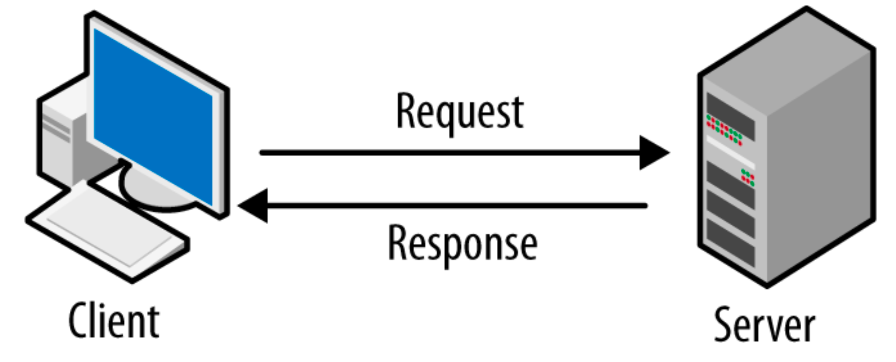
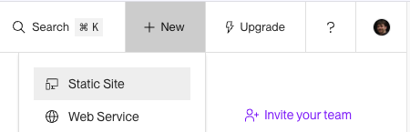
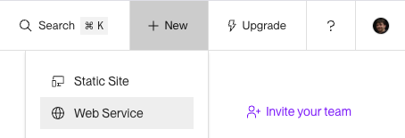

# Raspodijeljeni sustavi (2026/2027)

## VJEŽBA 1: Razvoj i deployment jednostavne klijent-poslužitelj arhitekture temeljene na HTTP protokolu

Arhitektura **klijent-poslužitelj** način je organizacije sustava u kojem klijent šalje zahtjev, a poslužitelj obrađuje zahtjev i vraća odgovor.

- **Klijent** je aplikacija koja traži podatke ili neku uslugu, primjerice web-preglednik ili mobilna aplikacija.
- **Poslužitelj** (_engl. server_) je program koji prima zahtjeve i odgovara na njih, primjerice dohvaćanjem podataka iz baze.

U web-aplikacijama klijent i poslužitelj najčešće komuniciraju putem **HTTP**-a, odnosno njegove šifrirane inačice **HTTPS**-a. JSON i HTML najčešći su formati podataka koji se prenose ovim protokolima, no mogu se prenositi i podaci u drugim formatima (npr. XML, CSV, binarni podaci).

Komunikacija se odvija prema načelu **zahtjev – odgovor** (engl. request–response):

1. **Klijent šalje zahtjev**; primjerice, preglednik traži jelovnik restorana: `GET /jelovnik`.

2. **Poslužitelj obrađuje zahtjev**; po potrebi dohvaća podatke iz baze.

3. **Poslužitelj vraća odgovor** → primjerice, status `200 OK` i podatke jelovnika u formatu JSON.

4. **Klijent prikazuje podatke** korisniku.

### Predznanje - studenti moraju ponoviti sljedeće gradivo:

- poznavanje arhitekture klijent-poslužitelj i protokola HTTP (`WA1`, `WA2`, `WA3`, `WA4`, `WA7`) ([FIPU prijediplomski - Web aplikacije](https://github.com/lukablaskovic/FIPU-WA))
- osnovno snalaženje u CLI-ju i Git-u (`OS1`, `OS2`) ([FIPU prijediplomski - Operacijski sustavi](https://github.com/lukablaskovic/FIPU-OS))
- sinkroni Python (`RS1`, `RS2`) (FIPU Diplomski - Raspodijeljeni sustavi, skripte iz Pythona na Merlinu 26/27)

> Važno je razumjeti osnovne programske koncepte i tehnologije iz web programiranja i klijent-poslužitelj arhitekture, koje ste do sada učili na prijediplomskom studiju. Ne morate znati svu sintaksu i detalje, već morate razumjeti osnovne koncepte i biti u stanju koristiti ih u praksi. Ako niste sigurni, pogledajte materijale s prijediplomskog studija i vježbe iz kolegija Web aplikacije i Operacijski sustavi.

> Važno! Za vježbe iz Raspodijeljenih sustava možete (i preporuka je ako ih imate) koristiti AI agente po izboru, npr. Claude Code, Cursor, Codex, Copilot, Openclaw... kako biste brže odradili manje bitan, repetitivan posao i fokusirali se na bitne dijelove vježbi iz ovog kolegija.

### Zadatak 0 - Instalacija softvera i priprema za daljnje vježbe

#### → 0.5 bodova

Za početak je potrebno instalirati nekoliko programa. Nećemo ih sve koristiti na prvim vježbama, ali trebat će vam za naredne vježbe. Preporuka je da ih sve instalirate odmah, kako biste se mogli posvetiti zadacima.

- CLI _shell_ po izboru (`Bash`, `zsh`, `Fish`)
  - `WSL`/`Git bash` (preporuka za Windows korisnike)
- `Node.js`
- `Git`
- `Python 3.12` ili novija inačica
  - Upravitelj Python paketa i okruženja po izboru (`uv`, `conda`, `venv`, `poetry`)
- _package manager_ (za korisnike Linuxa/macOS-a, npr. `apt`, `homebrew`, `yay`, `pacman`)
- `VS Code` ili drugi editor/IDE po izboru
- `Postman` ili drugi HTTP klijent po izboru
- `GitHub`/`GitLab` ili drugi servis za pohranu Git repozitorija

> Napomena: nije potrebno instalirati sve navedene programe, neki od navedenih su za različite operacijske sustave. Međutim, svakako morate imati instaliran `Git`, `Python` i `Node.js`, neki CLI _shell_ i IDE/editor po izboru. Ostale programe možete instalirati kasnije, po potrebi.

> Ako imate problema s instalacijom, javite se asistentu.

**VAŽNO!** Za kraj, potrebno je izraditi repozitorij za vježbe, npr. `RS-vjezbe`/`Raspodijeljeni-sustavi-vjezbe` i ovaj zadatak pohraniti u direktorij `vjezbe_1`. [Detaljnije upute ovdje](https://moodle.srce.hr/2026-2027/course/section.php?id=3403144#section-21).

### Zadatak 1

#### → 0.5 bodova

Ručno ili koristeći AI, izradite jednostavan frontend web-aplikacije u tehnologiji po izboru (Vue.js, React, Angular, Svelte...) ili složite statičnu HTML/CSS/JS stranicu. Jedini je uvjet da poslužujete statični sadržaj koji sadrži `index.html`, npr. iz direktorija `dist` ili `build`.

Aplikacija mora biti u novoizrađenom Git repozitoriju za vježbe (pogledaj upute iznad), u **direktoriju prvih vježbi**, npr. `RS-vjezbe/vjezba_1/frontend_app`.

Ručno deployajte poslužitelj kao **statičnu web-stranicu** na cloud servisu **Render.com** (izradite besplatan račun ako ga nemate). Po završetku vaš frontend mora biti dostupan na nekom URL-u na Renderu i imati spreman HTTPS certifikat, npr. `https://rs-vjezbe-demo.onrender.com/`

**VAŽNO!** Nakon uspješnog deploymenta, unutar direktorija gdje se nalazi source code frontend aplikacije, dodajte javni URL na deployanu Render aplikaciju, npr. u datoteku `frontend_app/README.md` ili `frontend_app/url.txt`.

### Zadatak 2

#### → 1 bod

Ručno ili koristeći AI, definirajte jednostavan web poslužitelj u frameworku po izboru (`Express.js`, `FastAPI`, `aiohttp`...). Izradite jednostavan REST API poslužitelj s nekoliko endpointa po želji i pripremite ga za deployment.

Aplikacija mora biti deployana kao **web-servis** na cloud servisu **Render.com**.

Deployajte servis i pošaljite nekoliko HTTP zahtjeva prema njemu koristeći:

- HTTP klijent s naredbenim sučeljem (npr. `curl`)
- HTTP klijent s grafičkim sučeljem (npr. `Postman`)

Nadogradite frontend tako da pošalje nekoliko HTTP zahtjeva na deployani web servis.

**VAŽNO!** Nakon uspješnog deploymenta, unutar direktorija gdje se nalazi source code backend aplikacije, dodajte javni URL na deployanu Render aplikaciju, npr. u datoteku `backend_app/README.md` ili `backend_app/url.txt`.

---

### Predaja vježbe

Verzionirajte ovu zadaću u izrađeni Git repozitorij, unutar direktorija `vjezbe_1`.

Frontend i backend aplikacije moraju biti u zasebnim direktorijima, npr. `vjezbe_1/frontend_app` i `vjezbe_1/backend_app` te odvojeno deployani na Renderu (dvije instance).

Kada završite s vježbom, učitajte na Merlin link na vaš Git repozitorij. Ako vam treba pomoć, ili želite komentar na zadaću, javite se na Chat ili ostavite komentar na Merlinu prilikom predavanja zadaće.

**ROK ZA PREDAJU: 8. studenog 2026. u 18 sati.**
